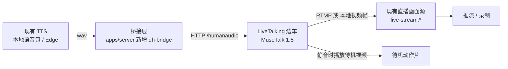
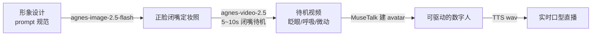

# 真实人物数字人 · 方案（2026-10-30）

> 需求：直播里出现「像真人」的主播，而不是现在的 VRM 卡通形象。
> 约束：商用产品、尽量离线、本机 **RTX 3050 6GB**、已有 TTS（本地语音包/Edge）与推流链路。

## 1. 结论

**走 MuseTalk 1.5（MIT，代码+权重都可商用），以本地边车（sidecar）进程形态接入，输出当成一路「画面源」。**

- 不选 Wav2Lip —— 它的权重是在 LRS2 上训的，**只许研究与个人使用，明确禁止商用**。LiveTalking 把它当默认引擎，照抄会踩雷。
- 不选 LatentSync / EchoMimic —— 商用许可干净，但 8~18GB 显存，6GB 跑不动、也不是实时。
- MuseTalk 是这批里唯一同时满足「MIT 可商用 + 实时（V100 上 30fps+）+ 6GB 量级显存」的。

## 2. 许可证盘点（这是本方案最关键的一张表）

| 项目 | 代码许可 | 权重能否商用 | 结论 |
|---|---|---|---|
| **MuseTalk 1.5**（腾讯音乐 Lyra Lab） | MIT | ✅ 明确允许（自带测试素材除外，别随包发） | **可用于产品** |
| Wav2Lip（IIIT-H） | 非商用（LRS2 训练数据） | ❌ 原仓库明文禁止 | **排除**，第三方 fork 转授无效 |
| LatentSync（字节） | Apache-2.0 | ✅ | 显存 18GB（v1.5 约 8GB），过重 |
| EchoMimic V2/V3（蚂蚁） | Apache-2.0 | ✅ | V3 约 12GB，过重 |
| SadTalker | 代码 Apache | ⚠️ 权重继承上游（PIRenderer 研究用途） | 只能内部试 |
| LivePortrait（快手） | 代码 MIT | ⚠️ 权重许可各来源说法不一（部分用 InsightFace 非商用模型） | 商用前必须逐条核对 |
| Ultralight-Digital-Human | **待核实** | 待核实 | 最轻（1~2GB、35~50fps），但要**按人训练** 3~5 分钟素材；许可没确认前不写进产品 |
| LiveTalking（lipku） | Apache-2.0（引擎） | 取决于所选子模型 | **架构参考/壳**，别用它的 wav2lip 档 |
| 云 API（HeyGen / D-ID / 硅基智能） | 商业条款 | ✅（付费） | 效果最好，但联网+按分钟计费+人像出网 |

> ⚠️ 易踩：**「引擎的许可证」不等于「模型的许可证」**。LiveTalking 是 Apache-2.0，但它默认跑的 Wav2Lip 权重是非商用的。

## 3. 候选对比

| 方案 | 真实感 | 实时性 | 显存 | 需要什么素材 | 一次性成本 |
|---|---|---|---|---|---|
| **MuseTalk 1.5** | 高（256×256 面部区贴回原片） | 实时（V100 30fps+；3050 需 fp16+小 batch，实测约 15~20fps） | 推理 4~6GB / 峰值 6~8GB | **一段静音、闭嘴、25fps 的真人视频**（10~30 秒够） | 权重 ~2GB |
| Ultralight | 中 | 最快（35~50fps） | 1~2GB | 3~5 分钟真人视频 + **训练数小时** | 权重 ~300MB + 训练 |
| LatentSync 1.6 | 很高 | 否（离线出片） | 18GB | 真人视频 | 权重数 GB |
| 云 API | 最高（带头部动作） | 1~3 秒 | 0 | 真人照片/视频 | 按分钟计费 |

## 4. 推荐架构



要点：

1. **边车而不是内嵌**：Python + torch + 2GB 权重，塞进 Electron 安装包会让体积再涨 4~6GB，且强制要求 N 卡。做成「本机可选服务」：有显卡才启用，没有就用现有 VRM 形象。
2. **接口只用一个**：`POST /humanaudio`（推一段 wav，引擎出声画同步的视频流）。我们的 TTS 已经能把整句合成成 wav，天然对接。
3. **画面进现有管线**：LiveTalking 支持 RTMP / 虚拟摄像头 / WebRTC，任选其一作为 `live-stream` 的画面源，**录制和推流代码一行不用改**。
4. **静音期**用「不说话时的待机视频」（LiveTalking 的动作编排），否则真人会像标本一样僵住。

## 5. 分阶段

| 阶段 | 内容 | 验收 | 预估 |
|---|---|---|---|
| **P0 出片验证** | 装 Python 3.10/3.12 + torch，跑通 MuseTalk 单段推理：一段真人视频 + 一段我们 TTS 的 wav → 出 mp4 | 肉眼对比口型是否对得上、3050 上出 8 秒片耗时多少 | 0.5~1 天 |
| **P1 接进直播** | LiveTalking 边车 + `dh-bridge`：TTS 说完就把 wav 丢进去，画面作为新场景「真人主播」 | 直播页出现第四种画面源，能录制 | 2~3 天 |
| **P2 体验打磨** | 待机视频、说话被打断、多句排队、首帧延迟优化、显存不足时自动降级到 VRM | 连续播 30 分钟不崩、显存不涨 | 2~3 天 |

## 6. 风险与前置条件

| 风险 | 说明 | 对策 |
|---|---|---|
| ~~真人素材与肖像权~~ | 已由「合成形象」路线规避（见 6.5）：脸是模型生成的 | 仍不允许拿真实名人当 prompt 目标 |
| 6GB 显存偏紧 | MuseTalk 峰值 6~8GB，开浏览器+Electron 时可能不够 | fp16、batch 4、静音检测跳过推理；显存不足降级到 VRM |
| 首帧延迟 | 一次推理链有几百毫秒预热 | 预热常驻、预生成待机帧 |
| 包体 | 权重 ~2GB | 按需下载（复用 `tts-packs` 那套多源下载+进度），不随安装包 |
| 口型准确度 | MuseTalk 的 LSE-C 低于扩散类；「静音测试」得分 0.68，不说话时嘴也会动 | 直播场景基本一直在说话，可接受；配上静音检测缓解 |

## 6.5 合成形象路线（不碰真人肖像）

**要点：不拍真人，全部由模型生成 —— 人脸是我们生成的，不存在肖像授权问题。**



三步都能在本机现有能力里走通：

| 步骤 | 用什么 | 产出去哪 |
|---|---|---|
| 定妆照 | agnes-image-2.5-flash（已实测可用） | `assets/hosts/<id>/portrait.png` |
| 待机视频 | agnes-video-2.5（图生视频，闭嘴、轻微呼吸/眨眼，5~10 秒） | `assets/hosts/<id>/idle.mp4` |
| 建 avatar | MuseTalk / LiveTalking `genavatar` | `data/avatars/<id>/` |

### 形象设计规范（决定能不能驱动）

给生图的 prompt 必须同时满足下面几条，否则后面对不上口型或贴不回画面：

1. **正脸、头部摆正**（3/4 侧脸会让 MuseTalk 的 256×256 面部区裁不准）
2. **闭嘴、唇线自然闭合**（张嘴的定妆照会被当成「已在说话」）
3. **纯色无缝背景**（浅灰最稳，换景/抠像都方便）
4. **柔和均匀的光**，避免硬阴影和反光（否则贴回时色差明显）
5. **竖构图、头肩居中**，头顶留一点余量
6. 不戴反光强的首饰/眼镜，衣服纯色为主

现成的通用 prompt 尾巴（三版都用了这段）：

> photorealistic half-body portrait, facing the camera directly, head straight and level, mouth closed with lips together, calm neutral expression, looking into the lens, plain seamless light grey studio background, soft even lighting, no harsh shadows, no text, no watermark, no logo, vertical composition, head and shoulders centered, sharp focus

### 三版候选（已生成，见 tmp/host-{a,b,c}.png）

| 版本 | 人设 | 适合场景 | 备注 |
|---|---|---|---|
| **A 亲和邻家** | 女 25 左右，齐肩黑发，米色针织 | 生活/带货/闲聊 | 正脸度最好，**首选** |
| B 知性专业 | 女 30 左右，低马尾，深蓝西装+白衬衫 | 知识科普/商务 | 这张偏 3/4 侧脸，需要重生一版正脸 |
| C 清爽男声 | 男 26 左右，短发，浅蓝衬衫 | 助手/工具类播报 | 正脸度好，适合当「助理」人格 |

### 边界

- 生成的脸不要刻意接近任何真实名人；
- 生图/生视频走的是我们自己配的平台（agnes），产出归我们；
- 换平台时注意它的条款：部分平台的生成内容有商用限制或强制水印。

## 7. 关于「初音未来 / DeepSeek 虚拟人」


- **初音未来**：形象走 Crypton 的 Piapro Character License，默认仅非商用，商用要单独授权谈判。不能内置。
- **DeepSeek 虚拟人**：品牌资产，同样需要授权。
- 想要「初音那种二次元质感但能商用」，现实做法是用 **VRoid 自建形象**（用户自己在 VRoid Studio 捏人导出 VRM，CC0 自持版权），或买商用的 VRM 素材。这条不影响上面的方案，VRM 与真人两条线可以并存（形象下拉里再加一档「真人」）。


## 9. P0 实测结果（2026-10-30，RTX 3050 6GB）

**跑通了。** 输入：AI 生成的正脸定妆照（转成 8 秒静帧视频）+ 系统中文语音合成的 8.3 秒 wav。
输出：`results/p0/v15/clip_test-zh.mp4`，8.31 秒（与音频等长），口型随音频开合，无接缝/鬼影。

| 指标 | 实测 |
|---|---|
| 模型加载（一次性） | ~60 秒 |
| 人脸检测 + landmark（200 帧） | 50 秒 |
| **生成 200 帧（8 秒视频）** | **104 秒**（约 0.52 秒/帧 ≈ **2 fps**） |
| 显存（batch=2） | 4.7 GB |
| 显存（batch=8） | 5.8 GB → **溢出到系统内存，第一批卡死 5 分钟** |

### 结论

- **质量过关**：这张脸口型自然，看不出是贴上去的。
- **速度不达标**：25fps 需要每秒 25 帧，现在 2 帧/秒 —— **比实时慢约 12 倍**。3050 上做不了「边说边出画」的实时直播。
- **显存是硬墙**：6GB 只能开 batch≤2；batch=8 会触发 Windows 显存溢出，表现是「GPU 100% 但一动不动」。

### 可行形态（按推荐顺序）

1. **离线出片**（当前硬件唯一可行）：TTS 整句 → 后台生成一段视频 → 播放/推流。适合口播短视频、预制直播素材；不适合互动问答。
2. **换硬件**：3090/4090（约 15~25 fps）。同样代码，只是 batch 和时间变小。
3. **云 API 兜底**：不挑硬件，按分钟付费。

### 优化空间（若继续用 3050）

- `--use_float16`：显存与速度都能改善，预计 1.5~2x；
- 常驻预热进程：省掉每次 60 秒模型加载；
- 只生成「说话段」：静音段直接复用待机帧；
- 降低输出帧率到 20fps：仍是 6 倍慢，治标不治本。

### 部署形态（用户选择下载）

按「本机跑、用户自愿装」设计，安装包不涨：

| 组成 | 体积 | 何时下载 |
|---|---|---|
| torch + CUDA 运行时 | ~2.6GB 下载 / 装完 ~5.5GB 盘 | 首次启用时 |
| 运行时权重（unet+vae+whisper） | ~3.7GB | 首次启用时 |
| 预处理权重（dwpose 等，仅建 avatar 用） | ~570MB | 建 avatar 时，用完可删 |
| avatar 数据 | 200~300MB/人 | 建一次 |

复用现有 `installer-registry` / `tts-packs` 那套「多源 + 进度 + 断点」下载机制，源优先 ModelScope
（GitHub/HF 在本机不可达，实测 ModelScope 3.7~8MB/s）。


## 10. 应用内落地设计（用户本机跑 + 自愿下载）

### 10.1 产品形态

直播页「场景」里新增一档 **真人主播**（`real-host`）。没装运行时的时候显示「启用需要下载 6.3GB」的引导卡片，
装完才能选。这与「虚拟人（VRM）」并列，用户可以随时切回去。

> 为什么不做成默认：6.3GB 下载 + 必须 N 卡，不该让不用的人付这个代价。

### 10.2 僵硬感的根因与唯一解

**根因**：MuseTalk 只替换嘴部区域，**底片里没有的动作它不会自己生成** —— 静帧底片 = 只有一个会动嘴的照片。

**唯一解：底片必须是「会动的」。** 三条路：

| 底片来源 | 自然度 | 肖像权 | 额外成本 |
|---|---|---|---|
| **用户上传自己的 10~30 秒视频**（推荐） | 最好 | 脸是用户自己的，天然无风险 | 无 |
| AI 生成的脸 + 图生视频 | 中 | 无 | 需要 I2V 能力（云 API 或 20GB+ 显存） |
| AI 生成的静帧（当前 P0） | 差（就是"僵"的来源） | 无 | 无 |

所以产品上的正解是 **HeyGen 式「克隆你自己」**：用户录一段视频，得到自己的数字人分身。
AI 生成的脸只作为「没有真人素材」时的降级方案，且必须配图生视频才不会僵。

### 10.3 代码结构

```
apps/server/src/digital-human/
  runtime.ts      # 定位/启动 python sidecar（venv 路径、端口、健康检查）
  installer.ts    # 运行时 + 权重的多源下载（复用 installer-registry 的形状）
  generate.ts     # 提交任务、轮询进度、产物落盘到 generated-videos
  sidecar/main.py # 只暴露一个接口：POST /speak {audio, baseVideo} → 输出 mp4
packages/ui/src/views/Live.vue          # 场景里加 real-host
packages/ui/src/components/live/RealHostPerformer.vue  # <video> 播放生成结果
```

复用点：
- TTS：现有本地语音包 / Edge（**换掉 SAPI，声音立刻不机械**）
- 推流/录制：现有 `live-stream`，把生成的 mp4 当一路画面源，零改动
- 下载：现有 `tts-packs` 的多源 + 进度 + 断点机制，源优先 ModelScope

### 10.4 速度诚实话术

| 机器 | 8 秒视频耗时 | 能做什么 |
|---|---|---|
| RTX 3050 6GB（实测） | 104 秒 | 只够离线出片 |
| RTX 3090 / 4090 | 15~30 秒 | 准实时（句间排队） |
| 无 N 卡 | 不可用 | 引导切回 VRM 形象 |

设置页要**先测后装**：跑 10 帧 benchmark，把「你这台机器大概 X 秒出一句」直接告诉用户，别让人下完 6.3GB 才发现跑不动。

## 8. 下一步

P0 只验证一件事：**3050 上 MuseTalk 出片的速度与口型质量**。跑通了再接管线；跑不通（显存/速度不达标）就转向云 API，不浪费时间。
