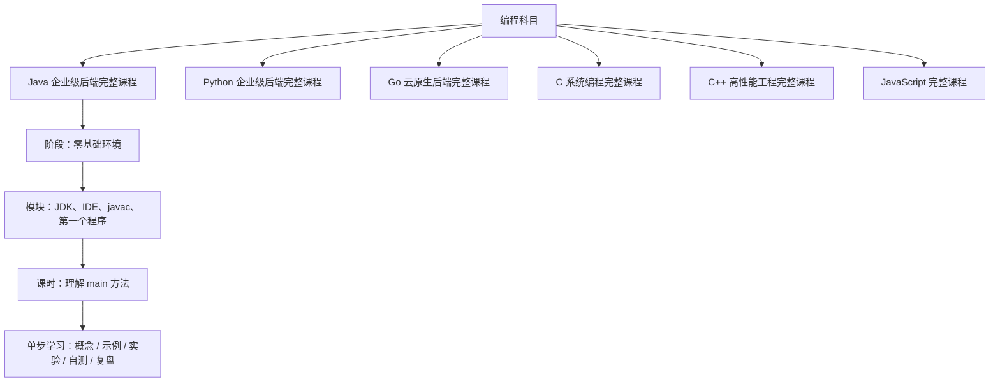

# 编程科目分语言课程体系重构方案

日期：2026-11-19

## 1. 结论

当前实现不合格。

根本问题不是课程数量少，而是信息架构错了：

- 当前把“知识点”当成了一门课程。
- Java 被拆成一组彼此并列的专题，无法呈现从安装 JDK 到源码、JVM、Spring、企业交付的连续成长。
- 其他语言也存在同类问题，用户看到的是一张知识点清单，不是一门能够从头学完的课程。
- “公共基础”与“语言课程”混在同一层，导致零基础用户不知道该从哪里开始。

新版结构必须改为：

> 编程科目是课程中心，不是课程本身。
>
> 每门语言是一门独立课程。
> 每门课程包含阶段、模块、课时和单步学习内容。



## 2. 必须先纠正的产品定义

### 2.1 课程

一门课程是完整、连续、有明确毕业标准的学习产品。例如：

- `Java 企业级后端：从零基础到 Spring 源码`
- `Python 企业级后端：从语法到 CPython 与框架源码`

一门课程必须从自己的运行环境安装开始，不能默认用户已经完成另一门“通识课”。

### 2.2 阶段

阶段是课程中的大能力跃迁，例如：

- 环境与语言入门
- 核心语法与面向对象
- 标准库与工程能力
- 并发与运行时
- 框架机制
- 框架源码
- 企业交付与毕业项目

### 2.3 模块

模块是一组可以连续学习的课时，例如：

- `ArrayList 扩容与迭代器失效`
- `ThreadPoolExecutor 状态机`
- `Spring Bean 生命周期`

### 2.4 课时

课时是用户实际打开的知识点。一个课时只显示一个学习步骤，不把整章内容平铺。

### 2.5 学习步骤

每课固定包含可追踪步骤：

1. 问题与直觉
2. 规则与机制
3. 代码与运行结果
4. 源码或规范证据
5. 跟做实验
6. 独立练习
7. 自测与复盘

## 3. 编程科目课程目录

编程科目首屏只展示独立课程，不再展示 60 多个并列知识点。

| 课程编号 | 独立课程 | 前置要求 | 毕业产出 |
| --- | --- | --- | --- |
| PROG-00 | 编程通识与计算机基础 | 无 | 能理解程序、数据、网络、数据库、Git、测试和部署基本闭环 |
| WEB-01 | HTML5：从零到语义化与可访问网页 | 无 | 能独立实现语义化、多端可访问页面 |
| WEB-02 | CSS3：从布局到设计系统 | HTML 基础 | 能完成响应式页面、组件样式和设计 Token |
| WEB-03 | JavaScript：从语言到浏览器工程 | HTML/CSS 基础 | 能实现可测试、可调试、可部署的前端应用 |
| WEB-04 | TypeScript：从类型到企业应用 | JavaScript 基础 | 能建立类型安全的前端 API、领域模型和工程配置 |
| WEB-05 | Vue 3：从零到源码 | HTML/CSS/JavaScript/TypeScript | 能完成 Vue 企业应用、源码分析和 SSR 部署 |
| WEB-06 | React：从零到 Fiber | HTML/CSS/JavaScript/TypeScript | 能完成 React/Next 应用、性能诊断和源码追踪 |
| BE-01 | Java 企业级后端：从零到 Spring 源码 | 无，课程自身从 JDK 安装开始 | JVM/Spring 源码、流式接口、企业服务和生产调优 |
| BE-02 | Python 企业级后端：从零到 CPython 与框架源码 | 无 | FastAPI/Django、SQLAlchemy、异步、性能与部署 |
| BE-03 | Go 云原生后端：从零到 Runtime 与源码 | 无 | Go 服务、goroutine 调度、gRPC、pprof 与云原生 |
| MID-01 | 中间件与源码：Kafka、Redis、RabbitMQ、Nginx、Apollo | 至少一门后端语言基础 | 能解释存储、网络、复制、消费组、路由、缓存、配置和故障恢复 |
| SYS-01 | C 系统编程：从零到真实项目源码 | 无 | 指针、ABI、POSIX、sanitizer、Redis/Nginx 源码 |
| SYS-02 | C++ 高性能工程：从零到 STL/Asio 源码 | 无，课程自身从工具链开始 | 现代 C++、STL、Asio、CMake、性能和生产诊断 |
| AI-01 | AI 编程与氛围编程 | 至少一门完整语言课程 | 规格、Agent、工具沙箱、代码评审、测试与安全交付 |
| ENG-01 | 软件工程、架构与项目交付 | 至少一门完整语言课程 | 模块化单体、分布式、K8s、CI/CD、SRE 和架构项目 |

不要求每个用户学完所有语言。所有课程都要存在，但个人路线只需完成：

- 一个前端主课程。
- 一个后端或系统主课程。
- 工程交付、AI 编程的公共能力。

## 4. Java 完整课程样板

Java 是第一门验收样板课。目标不是 14 个 Java 专题，而是 1 门从零到高深、约 120 至 130 个课时的完整课程。

### 4.1 课程目标

用户从没有安装过 JDK 开始，最终能够：

1. 独立编写、测试、调试 Java 程序。
2. 理解集合、异常、泛型、IO、反射、注解和类加载。
3. 解释 JMM、并发工具、线程池、虚拟线程和 JVM 内存模型。
4. 使用 GC 日志、JFR、线程栈、堆转储和 benchmark 做 JVM 调优。
5. 掌握 JDK 8 到当前 LTS 的语言演进和迁移风险。
6. 解释 Spring Framework、Boot、Security、Data、Cloud、AI 和 MyBatis 的机制与源码调用链。
7. 实现 SSE、WebFlux 和其他流式接口，处理背压、取消、超时和代理缓冲。
8. 实现 Spring/MyBatis 多数据源、读写分离、独立事务管理器和跨库一致性。
9. 使用 Kafka 实现可靠事件生产消费，并能沿日志存储、网络发送和消费组源码解释行为。
10. 完成带鉴权、数据库、事务、缓存、消息、可观测性、部署和回滚的企业项目。

### 4.2 课程阶段

| 阶段 | 课时 | 核心模块 | 阶段产出 |
| --- | --- | --- | --- |
| J0 零基础环境与第一行代码 | 8 | JDK LTS、IDE/命令行、项目目录、javac、main、变量、调试、构建 | 独立编译、运行和调试程序 |
| J1 Java 语言核心 | 14 | 类型、运算符、流程控制、方法、数组、包、作用域、字符串、枚举、日期时间 | 完成命令行工具 |
| J2 面向对象与设计基础 | 12 | 类、对象、构造器、封装、继承、组合、接口、抽象类、多态、内部类、Record、sealed | 完成可扩展订单模型 |
| J3 集合、泛型、异常与 IO | 14 | List、Map、Set、队列、泛型擦除、异常体系、try-with-resources、文件、NIO、序列化 | 完成数据导入导出工具 |
| J4 并发与 JMM | 12 | 线程、锁、volatile、CAS、原子类、AQS、并发集合、线程池、CompletableFuture、虚拟线程、竞态测试 | 完成并发任务系统 |
| J5 JVM 与性能 | 12 | class 文件、字节码、类加载、堆、元空间、栈、GC、JIT、JFR、线程转储、堆转储、调优 | 完成一次 JVM 调优报告 |
| J6 JDK 8 到当前 LTS | 10 | Lambda、Stream、模块、var、HttpClient、文本块、Records、模式匹配、virtual threads、移除与弃用 | 完成一次真实版本迁移 |
| J7 Spring 机制 | 10 | IoC、BeanDefinition、Bean 生命周期、DI、AOP、事务、事件、Boot 自动配置、配置优先级、启动失败分析 | 能从零搭建 Spring 服务 |
| J8 Spring 家族源码 | 12 | refresh、SpringApplication、DispatcherServlet、FilterChainProxy、Data 仓库代理、Cloud Gateway、Spring AI、MyBatis | 完成五条源码调用链报告 |
| J9 中间件、多数据源、流式与云 | 14 | Kafka、Redis、RabbitMQ、多数据源、读写分离、WebFlux、SSE、背压、安全、网关、负载均衡 | 完成可靠消息与多数据源服务 |
| J10 企业项目 | 10 | 模块边界、API、迁移、事务、幂等、缓存、MQ、Docker、K8s、CI/CD、监控、回滚 | 完成可部署企业系统 |
| J11 毕业项目与源码答辩 | 6 | 性能、故障演练、源码答辩、架构 ADR、运行手册 | 接管 Brownfield 项目并完成演进 |

合计 110 个课时。每课时包含 5 至 7 个学习步骤。

### 4.3 Java 项目主线

整门课使用一条持续演进的项目主线，不重复做玩具练习：

1. J0-J1：CLI 任务管理器。
2. J2-J3：加入领域模型、文件持久化和导入导出。
3. J4-J5：加入并发任务、性能指标和 JVM 诊断。
4. J7-J8：迁移为 Spring API，并从机制进入框架源码。
5. J9：加入 Kafka、Redis、RabbitMQ、多数据源、读写分离、SSE 和 WebFlux。
6. J10-J11：加入 Kubernetes、可观测性、灰度、回滚和故障演练。

### 4.4 Java 源码清单

#### Java / JDK

- `ArrayList` 扩容、`HashMap` 树化、`ConcurrentHashMap` 桶级并发。
- `ThreadPoolExecutor` 状态机、`AQS`、`CompletableFuture`。
- `ClassLoader`、双亲委派、模块系统。
- `MethodHandle`、动态代理、注解处理。
- JFR 事件、GC 日志、JIT 编译与去优化。

#### Spring Framework

- `DefaultListableBeanFactory`
- `AbstractApplicationContext#refresh`
- Bean 后置处理器和生命周期
- AOP 代理与 `TransactionInterceptor`
- `DispatcherServlet#doDispatch`
- Spring 事件和资源管理

#### Spring Boot

- `SpringApplication#run`
- 自动配置导入链
- `@Conditional` 条件装配
- 配置属性绑定与优先级
- 启动失败分析器
- Actuator、Micrometer 和测试切片

#### Spring Security

- `FilterChainProxy`
- `SecurityFilterChain`
- 认证管理器、授权管理器和安全上下文
- 方法级授权代理
- 会话、JWT、OAuth2 资源服务器

#### Spring Data / MyBatis

- `RepositoryFactorySupport`
- 查询方法解析和代理执行
- 事务和异常转换
- `MapperProxy`
- `SqlSession`、`Executor`、`StatementHandler`、`ResultSetHandler`
- 动态 SQL、分页、插件和慢查询治理

#### Spring Cloud / Gateway

- 服务发现与负载均衡
- Gateway 过滤器链
- 路由、限流、重试、熔断
- 配置中心和灰度
- Trace 上下文传播

#### Kafka

- `KafkaProducer`、`Sender`、`RecordAccumulator`、`NetworkClient`
- Producer 幂等、acks、重试、批处理和事务
- `KafkaConsumer`、`Fetcher`、订阅状态和位移提交
- `ConsumerCoordinator`、消费组协议和 Rebalance
- `GroupCoordinator`、`GroupMetadataManager`
- `UnifiedLog`、`LogSegment`、`LogManager`、索引和 retention
- `ReplicaManager`、Leader/Follower、ISR 和高水位
- 消息顺序、重复消费、死信、积压和消费限流
- Kafka 故障实验：Broker 下线、分区 Leader 切换、消费者 rebalance、重复消费、积压和磁盘增长

#### Spring / MyBatis 多数据源

- `AbstractRoutingDataSource`
- `determineCurrentLookupKey`
- `TransactionAwareDataSourceProxy`
- `DataSourceTransactionManager`
- `JdbcTemplate` 与 `SqlSessionTemplate`
- 多数据源下的 MyBatis `SqlSessionFactory`
- 数据源上下文清理、线程复用和事务绑定
- 多事务管理器与 `@Transactional(transactionManager = "...")`
- 读写分离、主库回写和复制延迟
- 连接池总量、每库配额和故障隔离
- 多源迁移、备份、监控和权限边界

#### Spring AI

- 模型客户端
- ChatClient / Prompt
- Advisor 链
- Tool Calling
- RAG 与向量存储
- 结构化输出、会话、超时和降级

#### 流式接口

- `SseEmitter`
- `StreamingResponseBody`
- `Flux<ServerSentEvent<?>>`
- 背压、取消、心跳
- Nginx/Ingress 缓冲和超时
- 慢客户端和连接资源限制
- 流式接口的 Trace 与首字节监控

## 4.5 中间件源码课程

中间件不能只教“怎么连”。课程按机制深度分为：

| 中间件 | 必须理解的机制 | 源码/实验范围 |
| --- | --- | --- |
| Kafka | 日志、分区、副本、ISR、位移、消费组、再平衡、幂等和事务 | `UnifiedLog`、`LogSegment`、`KafkaProducer/Sender`、`KafkaConsumer/Fetcher`、`ConsumerCoordinator`、`GroupCoordinator`、`ReplicaManager` |
| Redis | 单线程事件循环、数据结构、过期、持久化、主从和集群 | `ae` 事件循环、dict、expire、RDB/AOF、复制和 cluster 关键路径 |
| RabbitMQ | Exchange 路由、Queue、ACK、重投、DLX 和流控 | AMQP 模型、交换机/队列状态、确认与死信流程；源码分析限定关键路径 |
| Nginx | 事件循环、连接、请求解析、upstream、缓冲和限流 | event cycle、upstream、proxy buffering、worker 和共享内存 |
| Apollo | 配置发布、版本、灰度、客户端监听和回滚 | Portal 发布链、Config Service、客户端缓存与通知 |
| HikariCP | 连接获取、归还、等待队列、超时和泄漏检测 | 连接池状态机、并发等待和故障实验 |
| Spring Cloud Gateway | 路由、过滤器、负载均衡和限流 | `RoutePredicateHandlerMapping`、过滤器链和响应写回 |

每项中间件必须完成：

1. 正常链路。
2. 一个故障链路。
3. 一次源码断点或日志追踪。
4. 一次容量或并发实验。
5. 一次恢复和回滚。

## 4.6 多数据源与跨库一致性

多数据源不是“配置两个 URL”：

- 数据源注册、连接池和健康检查。
- 请求、租户或业务标签如何决定路由。
- `ThreadLocal` 上下文何时设置、何时清理。
- 事务开始后为什么不能随意切换数据源。
- 不同事务管理器和 `@Transactional` 边界。
- MyBatis/JPA/JdbcTemplate 如何绑定各自 SqlSession 或 Connection。
- 读库延迟、写后读、强制主库和降级。
- 分库分表与逻辑表路由的区别。
- 跨库写操作的 Outbox、Saga、补偿和幂等。
- 多库迁移、回滚、备份和一致性校验。
- 多数据源监控、连接泄漏和单库故障隔离。

实验至少包含：

1. 双数据源读写路由。
2. 事务中错误切换数据源的失败复现。
3. 主从延迟导致写后读错误。
4. Kafka Outbox 最终一致。
5. 一个数据源故障时的隔离和恢复。

## 5. 其他语言课程大纲

### 5.1 HTML5

1. 浏览器、文档与开发工具。
2. 语义元素、标题、段落、链接和图片。
3. 表单、输入类型、验证和错误提示。
4. 表格、列表和媒体。
5. 可访问性、键盘、ARIA 和阅读顺序。
6. SEO、Open Graph、结构化数据和页面性能。
7. 从零实现一个可访问企业官网。

### 5.2 CSS3

1. 级联、继承、特异性、层叠层。
2. 盒模型、逻辑属性、单位与尺寸。
3. Flex、Grid、定位、溢出。
4. 响应式、容器查询和移动端布局。
5. 字体、色彩、间距、动效与设计 Token。
6. 主题、暗色模式、可访问对比度。
7. 组件样式、设计系统和性能。
8. 从零实现一套响应式后台界面。

### 5.3 JavaScript

1. 运行环境、类型、作用域、闭包。
2. 对象、原型、class 和 this。
3. 调用栈、事件循环、Promise、async/await。
4. DOM、事件、Fetch、Web Storage。
5. 模块、包管理、Vite 和测试。
6. 浏览器渲染、性能、安全和可访问性。
7. 工程化重构与浏览器项目部署。

### 5.4 TypeScript

1. 类型系统与编译配置。
2. 联合、收窄、泛型、工具类型。
3. 领域建模与不可变状态。
4. API 契约、运行时校验和错误模型。
5. 类型测试、迁移和第三方类型。
6. 企业级项目与库发布。

### 5.5 Vue 3

1. 从零创建 Vue 项目和单文件组件。
2. 模板、响应式、computed、watch。
3. 组件、插槽、事件、组合式 API。
4. Router、Pinia、请求和权限。
5. Vite、测试、可访问性与性能。
6. Nuxt、SSR、hydration、部署和错误监控。
7. 源码：响应式、渲染器、scheduler、compiler。
8. 企业项目与 Brownfield 接管。

### 5.6 React

1. 从零创建 React 项目和 JSX。
2. 组件、Props、State、不可变更新。
3. Hooks、Effect、并发渲染边界。
4. Router、Query、缓存和表单。
5. Next.js、SSR/RSC、部署与监控。
6. 源码：Fiber、Hooks、Scheduler、commit。
7. 性能、测试、企业项目与 Brownfield 接管。

### 5.7 Python

1. 环境、解释器、语法和数据结构。
2. 函数、模块、面向对象和数据模型。
3. 异常、上下文管理器、生成器、装饰器。
4. 类型提示、测试、打包和 uv。
5. 文件、网络、数据库和异步。
6. CPython 字节码、GIL、内存和性能。
7. FastAPI、Django、SQLAlchemy、迁移和安全。
8. 部署、可观测性、故障处理和企业项目。

### 5.8 Go

1. 工具链、模块、类型和控制流。
2. 结构体、接口、错误和 context。
3. goroutine、channel、select。
4. GMP 调度、内存模型、GC。
5. net/http、Gin、gRPC、数据访问。
6. 测试、race、fuzz、pprof 和 benchmark。
7. 镜像、部署、可观测性和企业项目。

### 5.9 C

1. 编译器、链接器、CMake 和第一个程序。
2. 类型、数组、指针、结构体、函数。
3. 栈、堆、生命周期、未定义行为。
4. ABI、libc、POSIX、文件、进程、socket。
5. GDB、strace、sanitizer、Valgrind、perf。
6. 数据结构、协议解析和资源管理。
7. Redis/Nginx 源码阅读。
8. 原生服务交付与故障诊断。

### 5.10 C++

1. 工具链、CMake Presets 和第一个程序。
2. 值语义、引用、类、RAII。
3. 移动语义、异常安全、智能指针。
4. 模板、concepts、STL 和算法。
5. 并发、原子、内存模型、Asio。
6. ABI、动态库、包管理、跨平台构建。
7. sanitizer、benchmark、perf 和 core dump。
8. STL/Asio 源码与高性能企业项目。

## 6. 课程内容标准

### 6.1 零基础定义

每门语言课程在第 1 阶段必须自己完成：

1. 安装运行时和工具链。
2. 创建目录和项目。
3. 编写第一个程序。
4. 编译或解释运行。
5. 使用调试器。
6. 编写第一个测试。
7. 解释一个错误和修复过程。

公共通识课可以帮助理解原理，但不是语言课程的隐藏前置。

### 6.2 每课必备内容

- 本课在项目中的位置。
- 前置知识与上一课连接。
- 一个可观察目标。
- 通俗解释和反例。
- 可编译或可执行代码。
- 版本和环境。
- 源码、规范或官方文档证据。
- 跟做实验。
- 无提示独立练习。
- 常见错误。
- 自测。
- 复盘与下一课过渡。

### 6.3 源码课的硬标准

每门源码课必须包含：

1. 固定仓库和 tag/commit。
2. 文件路径和符号名。
3. 调用链图。
4. 关键数据结构。
5. 可运行实验。
6. 失败路径。
7. 一个最小修改或扩展。
8. 设计取舍总结。

不能只出现“阅读源码”四个字。

## 7. UI 与交互

### 7.1 编程科总览

桌面和移动都先显示独立课程，不显示 60 多个并列知识点。

每张课程卡只显示：

- 课程名。
- 适用方向。
- 前置要求。
- 总课时和预计时长。
- 当前进度。
- 继续学习按钮。

课程按“前端 / 后端 / 系统 / AI 与工程”分组，但不再把语言、模块、知识点混在同一层。

### 7.2 课程主页

打开 Java 课程后显示：

- 课程简介。
- 毕业能力。
- 阶段路线。
- 当前阶段。
- 项目主线。
- 已完成课时。
- 继续学习入口。

### 7.3 阶段页

一次只展示一个阶段：

- 阶段目标。
- 模块列表。
- 每个模块的课时数、难度和项目产出。
- 阶段验收。

### 7.4 课时沉浸台

- 覆盖总览、课程主页和全局导航。
- 一次只显示当前学习步骤。
- 顶栏只有返回、课程名、步骤进度、朗读和退出。
- 底部固定上一页/下一页。
- 代码和源码卡可横向滚动，不能撑破移动端。

### 7.5 移动端

- 顶栏“编程 ▾”。
- 课程总览显示课程卡或单列清单。
- 课程内路线用“阶段下拉 + 课时横轨”。
- 一个阶段一个课时条，不使用超长平铺页面。
- 退出后恢复课程、阶段、课时和步骤。

## 8. 数据模型

通用 Learning V2 继续服务其他 19 科。编程科新增可选课程中心模型：

```ts
type ProgrammingCoursePackage = {
  id: string;
  title: string;
  language: string;
  category: 'foundation' | 'frontend' | 'backend' | 'systems' | 'engineering' | 'ai';
  levelRange: 'zero-to-advanced';
  prerequisites: string[];
  targetRole: string;
  runtimeVersions: Record<string, string>;
  stages: ProgrammingStage[];
  capstones: ProgrammingProject[];
};

type ProgrammingStage = {
  id: string;
  title: string;
  goal: string;
  modules: ProgrammingModule[];
  acceptance: string[];
};

type ProgrammingModule = {
  id: string;
  title: string;
  lessons: ProgrammingLesson[];
  sourceAnchors?: SourceAnchor[];
};

type ProgrammingLesson = {
  id: string;
  title: string;
  minutes: number;
  steps: LearningV2LessonStep[];
  lab?: string;
  assessment?: string;
};
```

现有 66 个微课程迁移为课时或模块内容，不再直接作为编程科课程卡。

## 9. 迁移计划

### 阶段 0：停止错误结构继续扩张

- 编程科标记为预览。
- 不再向扁平微课程列表增加条目。
- 现有内容全部保留为迁移素材。

### 阶段 1：Java 样板课纵向切片

- 建立课程包数据结构。
- 完成 Java 课程主页、阶段页和课时沉浸台。
- 先完成 J0-J3 的零基础部分并验收。
- 每课代码可编译，测试和来源通过。

### 阶段 2：完成 Java 高深部分

- 并发、JVM、JDK 演进。
- Spring 机制与家族源码。
- Kafka、Redis、RabbitMQ、HikariCP 和 Apollo 的中间件源码实验。
- Spring/MyBatis 多数据源、读写分离、事务边界和跨库一致性。
- SSE/WebFlux/背压。
- 企业项目和 Brownfield。
- Java 全部 110 课完成后才标记为正式课程。

### 阶段 3：复制课程模板到后端和系统语言

- Python、Go、C、C++。
- 每门课程必须先完成零基础阶段，再进入源码和企业项目。

### 阶段 4：前端课程拆分

- HTML、CSS、JavaScript、TypeScript、Vue、React 各自独立课程。
- 前端课程通过前置关系连接，不混成一张课程列表。

### 阶段 5：AI 与工程课程

- AI 编程与氛围编程。
- 软件工程、架构、部署与运维。

### 阶段 6：全量验收

- 每门课程可从零开始。
- 每门课程有阶段、模块、课时和毕业项目。
- 每门课程可单独完成和个人选路。
- 桌面与移动双端完成视觉和交互验收。

## 10. 验收标准

- [ ] 编程科首屏展示的是独立课程，不是知识点列表。
- [ ] Java 是一门连续课程，第一阶段从安装 JDK 开始。
- [ ] Java 课程完整覆盖语言、OOP、集合、并发、JVM、JDK 8 到当前 LTS、Spring 机制、Spring 家族源码、SSE/WebFlux、Kafka、多数据源和企业交付。
- [ ] Kafka 课程深入日志存储、Producer/Consumer、消费组再平衡、ISR、幂等、事务和故障实验。
- [ ] 中间件课程至少覆盖 Kafka、Redis、RabbitMQ、Nginx、Apollo、HikariCP 和 Cloud Gateway 的关键源码路径。
- [ ] 多数据源课程覆盖路由、连接池、事务管理器、MyBatis/JPA、读写分离、复制延迟、Outbox/Saga、监控和回滚。
- [ ] 每门语言课程有自己的环境准备、项目主线、阶段验收和毕业项目。
- [ ] 每门课程有 5 至 7 步课时教学，不使用整页长文。
- [ ] 每门源码课有固定版本、文件、符号、调用链和实验。
- [ ] 代码样例通过编译或运行测试。
- [ ] 移动端课程路线不出现 60 多个节点的纵向平铺。
- [ ] 语言课程可以被单独选择，不要求先学完公共通识课。
- [ ] 课程进度按课程、阶段、课时三层保存和恢复。

## 11. 当前实现处置

- 保留已经完成的数据作为课程素材。
- 不继续扩展旧的扁平课程结构。
- 在 Java 样板课完成前，编程科不作为正式完成课程对外。
- 首先实现与验收 Java，再批量迁移其他语言，避免再次出现“所有语言都只有目录和提纲”的问题。
