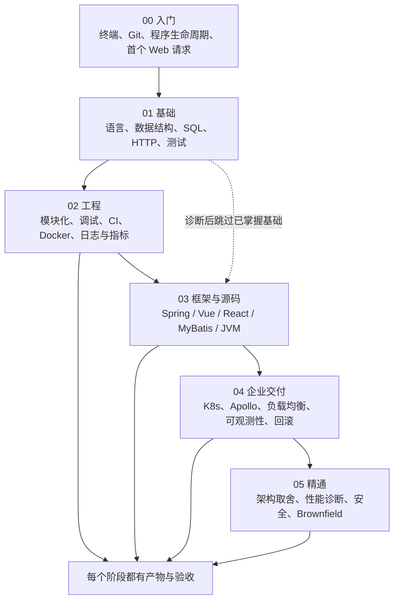
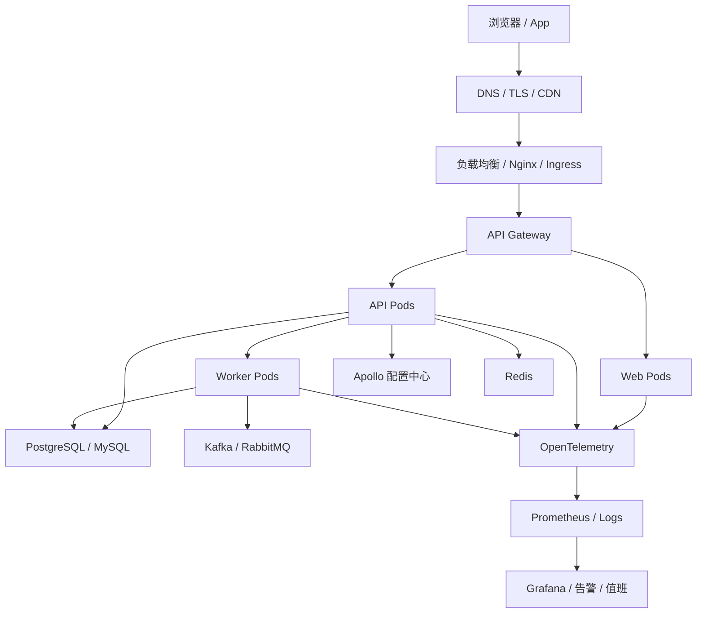
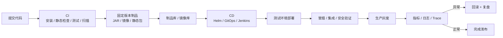

# 编程科目课程体系方案

日期：2026-11-19

> 重要修订（2026-11-19）：本文件保留课程领域、源码深度、企业交付和双端约束；其中“知识点作为课程”的粒度已作废。正式实施必须以 `docs/编程科目分语言课程体系重构方案-2026-11-19.md` 的“每门语言一门独立课程、课程内含阶段/模块/课时”结构为准。

## 1. 结论

编程不作为普通课程列表追加，而作为学习 V2 中的第 20 个独立科目，采用“一条通识主干 + 多条专业分支 + 横切工程能力 + 可跳过诊断”的结构。

目标不是把六种语言做成语法词典，而是让学习者在每条路线结束时具备以下能力：

1. 能说明语言、运行时、编译器和标准库之间的边界。
2. 能用规范和源码解释“为什么这样写”，而不是只记 API。
3. 能阅读真实框架源码，定位入口、状态机、关键数据结构和扩展点。
4. 能通过测试、调试、性能分析和安全审查交付可维护代码。
5. 能判断何时使用设计模式、框架、缓存、消息队列或微服务，以及它们的代价。
6. 能在 AI 辅助下完成需求、实现、评审、验证和发布，但不把正确性外包给模型。
7. 能从干净环境搭建项目、完成开发、产出可部署制品、部署到服务器并处理常见运维故障。

这里的“能进行企业级项目”不是“学完直接成为架构师”，而是能进入企业项目并独立完成一个小型生产闭环：

- 在干净机器上复现开发环境。
- 从空目录搭建项目骨架，而不是只会运行生成器。
- 完成一条包含前端、后端、数据库和权限的功能。
- 让代码通过类型检查、测试、安全扫描和构建门禁。
- 产出不可变制品并部署到测试/生产环境。
- 查看日志、指标、追踪和告警，处理失败发布并回滚。
- 写清运行手册，让另一个人能按文档启动、部署和排障。

## 2. 范围与非目标

### 包含

- 编程通识、数据结构、算法、计算机系统、网络和数据库基础。
- HTML、CSS、JavaScript、TypeScript。
- Vue 3、React，以及 Vue Router、Pinia、Nuxt、React Router、TanStack Query、Next.js 等主流生态。
- Java、Python、Go、C、C++。
- 后端公共能力：HTTP、API、认证授权、事务、缓存、消息、可观测性和部署。
- 设计模式、编程思想、重构、代码质量、性能优化和安全。
- 氛围编程、AI 辅助编程、AI Agent 工程和代码安全。
- 架构设计、项目管理、交付、故障复盘和技术领导。

### 不包含

- 把“最新语法”当成课程主线；课程锁定版本，并在官方发布新版本后走内容升级流程。
- 用一句通用模板生成所有语言的课程正文。
- 把 C/C++ 伪装成主流 Web 业务后端。C 走系统编程路线，C++ 走高性能工程与服务路线，并在课程中明确其适用边界。
- 在应用内无约束执行任意语言代码。首版实验以可复制代码、固定命令、预期输出和本地测试为主；后续若接入执行器，必须使用受限沙箱。

## 3. 学习模型

### 3.1 四层结构

1. **通识主干**：不选语言也必须掌握的程序、数据、系统、网络、数据库和工程方法。
2. **专业分支**：前端、后端、系统底层三条路径；每条路径内部再分语言与框架。
3. **横切能力**：设计模式、代码质量、性能、安全、可观测性，贯穿所有语言分支。
4. **高级综合**：AI 编程、架构设计、项目管理与端到端交付。

### 3.2 入口方式

- **零基础路线**：通识主干 → Web 基础 → 任选前端或后端。
- **有经验程序员路线**：先做诊断，跳过已掌握的基础课，直接进入框架源码、性能、安全和架构。
- **前端路线**：HTML/CSS → JavaScript/TypeScript → Vue 或 React → 前端工程化 → 框架源码。
- **后端路线**：网络与数据库 → Java、Python、Go 或 C++ → Web 框架 → 数据访问 → 并发 → 框架源码。
- **系统路线**：C → 操作系统与 ABI → 调试与安全 → C++ → STL/Asio 源码 → 高性能工程。
- **技术负责人路线**：主干速通 → 一个前端与一个后端方向 → 架构 → 交付与项目管理。

路线不是硬锁。前置知识用于提示和推荐，不阻止有经验的用户直接进入某节课；课程页面必须明确“本课需要什么前置能力”。

所有语言分支都可以学习，但单个学习者应选择一个前端主路线和一个后端主路线完成企业项目；不要求小白把六种后端语言都学到同等深度。C/C++ 学习者可用 Web 分支做管理界面，以原生程序作为核心服务完成同一套部署和运维闭环。

### 3.3 企业交付毕业门槛

| 门槛 | 能力 | 可验收结果 |
| --- | --- | --- |
| E0 环境复现 | 版本、依赖、工具链和本地服务可控 | 新机器按 README 一次成功启动；锁定文件和版本说明齐全 |
| E1 项目搭建 | 从空目录建立可运行骨架 | 目录结构、配置、错误处理、日志、健康检查、测试入口和 CI 可工作 |
| E2 功能闭环 | 需求到可部署功能 | 完成数据库变更、API、前端交互、权限校验和无障碍状态 |
| E3 质量门禁 | 代码可维护、可测试、可审计 | 类型/静态检查、单测、集成测试、构建、依赖扫描和秘密扫描通过 |
| E4 部署回滚 | 制品可发布、可恢复 | 容器或等价制品可部署；配置与密钥分离；发布、冒烟和回滚有记录 |
| E5 运维处置 | 运行状态可见、故障可处理 | 日志、指标、追踪、告警、备份恢复、容量检查和事故复盘有证据 |

每门与交付有关的课程都要对应至少一个 E 级门槛，不能只写“了解部署”或“熟悉 Linux”。

### 3.4 从入门到精通运行图



“精通”的判定不是课程进度 100%，而是能对一个陌生项目完成以下闭环：

1. 根据日志、指标、Trace 和运行手册定位问题。
2. 读懂关键调用链和框架源码，提出有依据的方案。
3. 说明不同方案的性能、可靠性、安全、成本和维护代价。
4. 完成代码、测试、发布、回滚和事故复盘。
5. 让另一名工程师按文档复现你的环境、部署和处置过程。

## 4. 课程地图

| 轨道 | 定位 | 核心内容 | 建议课时单元 |
| --- | --- | --- | --- |
| P00 编程通识 | 所有路线必修 | 程序生命周期、终端、Git、函数、状态、数据结构、测试、调试、首次请求、首次事务 | 18-24 |
| P01 算法与计算机系统 | 主干加深 | 复杂度、递归、树与图、栈堆、进程线程、CPU/IO、网络、数据库存储 | 20-28 |
| P02 HTML/CSS/浏览器 | 前端基础 | 语义 HTML、表单、可访问性、级联、布局、响应式、渲染、性能 | 18-24 |
| P03 JavaScript/TypeScript | 前端与通用脚本 | 类型、作用域、闭包、原型、事件循环、异步、模块、DOM、类型系统 | 24-32 |
| P04 Vue 与生态 | 前端分支 | 响应式、组件、组合式 API、路由、状态、SSR、测试、性能、源码 | 18-24 |
| P05 React 与生态 | 前端分支 | 组件、状态、Hooks、渲染、路由、数据获取、SSR/RSC、性能、源码 | 18-24 |
| P06 后端公共能力 | 后端基础 | HTTP、REST、校验、事务、缓存、消息、认证授权、日志、部署 | 18-24 |
| P07 Java/JVM/Spring | 后端分支 | 集合、并发、类加载、JVM、GC/JIT、Spring、Spring AI、MyBatis、Netty、源码 | 26-36 |
| P08 Python/CPython/框架 | 后端分支 | 数据模型、类型、异步、打包、CPython、FastAPI、Django、SQLAlchemy | 20-28 |
| P09 Go/Runtime/云原生 | 后端分支 | 类型、错误、context、goroutine、调度器、GC、net/http、Gin、pprof | 20-28 |
| P10 C/系统编程 | 系统分支 | 指针、ABI、内存、libc、POSIX、系统调用、调试、安全、Redis/Nginx 源码 | 16-24 |
| P11 C++/高性能工程 | 系统分支 | 值语义、RAII、模板、STL、移动、并发、ABI、CMake、Asio、性能 | 20-28 |
| P12 设计模式与编程思想 | 全路线横切 | 抽象、契约、组合、状态、错误、依赖、模式代价、重构、反模式 | 16-24 |
| P13 质量/性能/安全 | 全路线横切 | 测试金字塔、性能测量、SQL/N+1、前端包体、内存、供应链、安全编码 | 18-26 |
| P14 氛围编程与 AI 工程 | 全路线横切 | 规格、上下文、计划、补丁、测试、评审、提示注入、权限、评测 | 14-20 |
| P15 架构与项目管理 | 高级综合 | 模块化单体、DDD、API、一致性、事件、可观测性、ADR、交付、复盘 | 20-30 |
| P16 企业交付与运维 | 全路线必修 | Linux、Docker、Compose、K8s、Helm、Nginx、负载均衡、Apollo、CI/CD、监控、备份、回滚、SRE | 24-34 |

首版不要求把每个单元一次全部上线。上线规则是：该分支只展示已通过内容契约的课程，不放“建设中”假课程，也不使用通用生成正文补位。

## 5. 每条语言分支的最低深度

每个语言分支都必须覆盖六级深度，缺一级就不能宣称“从浅入深”：

1. **L0 语言心智模型**：代码如何变成可执行程序，工具链、生命周期和错误模型是什么。
2. **L1 核心语义**：类型、值/引用、作用域、控制流、模块、标准库和惯用法。
3. **L2 可靠性**：测试、调试、错误处理、日志、边界输入和失败恢复。
4. **L3 运行时与性能**：并发、内存、调度、GC、ABI、剖析和瓶颈定位。
5. **L4 框架与源码**：主流框架的入口、关键数据结构和扩展点，能沿调用链解释行为。
6. **L5 生产工程**：安全、依赖、发布、可观测性、负载、故障和演进。

### 5.1 各语言的源码深挖入口

| 分支 | 必读源码主题 | 课程实验 |
| --- | --- | --- |
| Vue | `@vue/reactivity` 的依赖收集、`runtime-core` 的渲染器与调度器、模板编译流程 | 写一个 100 行以内的响应式系统；跟踪一次更新队列；对照真实源码找差异 |
| React | Fiber 工作循环、begin/complete work、Hooks 链表、Scheduler 优先级 | 写一个迷你渲染器；记录一次 setState 到提交的调用链；比较并发渲染行为 |
| Java/Spring | `DefaultListableBeanFactory`、容器 refresh、DispatcherServlet、AOP 代理、事务拦截器 | 用断点跟踪一次 Bean 创建和一次 MVC 请求；复现一个事务传播问题 |
| Python | 数据模型与描述符、生成器、asyncio 事件循环、CPython 字节码与 GIL 边界 | 用 `dis` 查看字节码；跟踪 FastAPI 依赖解析；比较同步与异步阻塞 |
| Go | `net/http` 服务循环、Gin 路由树、goroutine 调度、channel 与 context、GC 标记阶段 | 用 `go test -race`、pprof 和 trace 定位泄漏；画一次请求到 goroutine 的状态转换 |
| C | libc/POSIX、文件与网络系统调用、Redis 事件循环、Nginx 事件驱动结构 | 用 ASan/UBSan 复现越界和悬空指针；用 strace/ltrace 观察系统调用 |
| C++ | `std::vector` 增长、`shared_ptr` 控制块、STL 算法实现、Asio 事件循环、ABI | 对比不同 STL 实现；用 sanitizer 和 benchmark 定位一次性能与生命周期问题 |

框架源码课必须固定仓库、版本标签或提交、文件路径和符号名。不把易漂移的行号当作唯一锚点。

### 5.2 各语言特色、工具链与项目能力

每个方向都要同时覆盖“语言特色、主流框架、开发工具、运行环境、项目搭建、构建部署、运行维护”，不能只讲语言语法。

| 方向 | 语言与运行环境特色 | 主流框架/库 | 开发与质量工具 | 项目搭建 | 构建与部署 | 运维重点 |
| --- | --- | --- | --- | --- | --- | --- |
| HTML/CSS/JavaScript/TypeScript | 浏览器事件驱动、DOM/CSS、异步 I/O；Node.js 主要承担工具链和 SSR | Vue、React、Vite、Vue Router、React Router、TanStack Query | 浏览器 DevTools、pnpm、TypeScript、ESLint、Prettier、Vitest、Playwright、Lighthouse | 从空目录建立静态站或 SPA，配置路由、环境变量、API 客户端和错误处理 | 静态产物部署 CDN/Nginx；SSR 部署 Node；配置缓存、CSP、source map | Web Vitals、RUM、错误聚合、资源 404、缓存失效、发布冒烟 |
| Vue | 响应式系统、模板编译、单文件组件；浏览器运行，Nuxt 可在 Node/边缘运行 | Vue 3、Vue Router、Pinia、Nuxt、VueUse | Vite、Vue DevTools、Vue Language Tools、vue-tsc、Vitest、Playwright | create-vue/Nuxt 只是起点；要逐文件解释目录、状态、路由、请求和环境配置 | SPA 静态部署；Nuxt SSR/SSG 部署 Node、容器或平台运行时 | hydration 错误、SSR 内存、节点健康检查、source map、客户端错误 |
| React | 函数组件、Hooks、不可变状态、渲染调度；Next.js 支持 Node/边缘运行 | React、React Router、TanStack Query、Next.js、Zustand/Redux（按场景） | Vite/Next、React DevTools、ESLint、Vitest/Jest、Testing Library、Playwright、Storybook | 从 Vite 或 Next 空项目建立边界清晰的组件、服务端/客户端边界、数据层和测试 | 静态导出或 Node/Next 部署；镜像优化、CDN、缓存策略 | hydration、客户端异常、服务端渲染日志、请求链路、版本回滚 |
| Java | 强类型、JVM、JIT、成熟并发和长生命周期服务 | Spring Boot、Spring Framework、Spring Security、Spring Data、MyBatis、Netty、Quarkus/Micronaut | IntelliJ IDEA、Maven/Gradle Wrapper、JUnit、Testcontainers、JaCoCo、Actuator、JFR、VisualVM | 从空 Gradle/Maven 工程搭多模块服务；配置 profile、数据库迁移、统一异常和健康检查 | 可执行 JAR、多阶段镜像、配置外部化；部署 VM/Kubernetes | JVM 内存、GC、线程与堆转储、Actuator/Micrometer、滚动发布、优雅停机 |
| Python | 动态类型、数据模型、解释执行；CPython 是默认运行时 | FastAPI、Django、SQLAlchemy、Pydantic、Celery（按场景） | uv/venv、Ruff、mypy/pyright、pytest、coverage、py-spy、Django Debug Toolbar | 使用 `pyproject.toml` 和 `src/` 布局；锁定依赖、配置、迁移、任务和测试 | Docker 镜像、Gunicorn/Uvicorn、非 root 运行；部署容器或 VM | 进程与 worker、内存增长、阻塞事件循环、依赖漏洞、日志与指标 |
| Go | 编译为单一二进制、goroutine、channel、低开销并发 | 标准库 `net/http`、Gin、Echo、gRPC-Go、GORM、sqlc | Go toolchain、`go mod`/`go work`、golangci-lint、staticcheck、pprof、Delve | 从模块和目录边界开始，配置 context、错误、日志、健康检查、迁移和 graceful shutdown | 静态二进制或 distroless 镜像；跨平台构建；部署容器/VM | goroutine 泄漏、CPU/内存 pprof、竞态、启动探针、优雅停机 |
| C | 贴近硬件、手动内存管理、ABI 稳定、可预测性能；依赖 libc/操作系统 | libc/POSIX、CMake、libuv、OpenSSL；学习 Redis、Nginx 等真实代码库 | GCC/Clang、CMake/Meson、pkg-config、GDB/LLDB、ASan/UBSan/TSan、Valgrind、clang-format/tidy | 从 CMake 工程建立库/守护进程；明确头文件、ABI、依赖、测试和安装规则 | 静态/动态链接、系统包或容器；交叉编译和 libc 兼容检查 | core dump、systemd、strace、perf、文件描述符、信号和内存泄漏 |
| C++ | 值语义、RAII、模板、零开销抽象和高性能工程；需处理 ABI 与工具链差异 | STL、Boost.Asio、gRPC、Qt、Abseil | CMake Presets、Conan/vcpkg、clang-tidy、GTest/Catch2、Google Benchmark、sanitizer | 从 CMake Presets 建立可复现工程；管理依赖、编译选项、测试、安装和包版本 | 发布二进制/共享库/容器；处理 glibc、ABI、调试符号和动态依赖 | core dump、性能剖析、内存/线程 sanitizer、符号化、发布兼容性 |

### 5.3 企业项目搭建标准

每个语言分支至少完成一次“从空目录到生产骨架”，并满足：

1. 目录职责清晰，业务代码、配置、测试、脚本、迁移和部署文件分离。
2. 语言、运行时、包管理器和依赖版本固定；提供锁文件或等价机制。
3. 本地、开发、测试、生产环境配置分开；仓库只提交 `.env.example`，不提交真实秘密。
4. README 写明安装、启动、测试、构建、部署、回滚和常见故障。
5. 提供一条命令启动依赖服务，优先使用容器或明确的本地安装说明。
6. 统一错误处理、结构化日志、健康检查和优雅停机。
7. 数据库变更使用迁移工具，禁止手工改生产表后不记录。
8. 单元测试、集成测试和关键 E2E 至少各有一层；测试数据可重复。
9. CI 执行依赖安装、静态检查、测试、构建、依赖/秘密扫描和制品产出。
10. 部署使用固定版本制品，不直接在服务器上 `git pull` 后临时构建。
11. 发布后有冒烟检查、日志/指标查看、失败回滚和备份恢复说明。
12. 提供最小运行手册：启动、停止、扩容、备份、恢复、排障和告警处理。

所有模板课都必须附“逐文件解释”和“删掉模板后重建”实验，避免学习者只会运行生成命令。

## 6. 重点课程群

### 6.1 编程思想与设计模式

不按“23 种模式速记”组织，而按问题、约束、成本和语言实现组织：

- 抽象与不变量：什么时候抽象，什么时候直接写。
- 接口、契约与依赖方向：依赖倒置、IoC 和可测试性。
- 组合优于继承的适用条件与反例。
- Strategy、State、Factory、Adapter、Decorator、Observer、Command、Repository 的真实使用和过度设计。
- 错误处理、资源生命周期、异步状态和副作用管理。
- 单一职责、耦合、内聚、命名和可演进性。
- 重构顺序：先建立回归测试，再小步改变结构。
- 反模式：万能基类、过度分层、无意义接口、只为“以后可能需要”而引入的模式。

每节课至少包含一个“不采用模式时怎么写”的对照，并要求学习者说明模式带来的复杂度。

### 6.2 代码优化

优化课不先讲技巧，先讲测量：

- 复杂度与真实数据的区别，基准测试和统计波动。
- 火焰图、CPU/内存剖析、分配次数、GC、锁竞争。
- 前端包体、首屏、渲染、长任务、布局抖动和网络瀑布。
- 后端 N+1、索引、连接池、序列化、缓存命中和背压。
- C/C++ 的缓存局部性、ABI、编译器优化和 sanitizer。
- 性能回归如何进入 CI，如何保留可复现的 benchmark。

### 6.3 安全

安全能力不单独堆在末尾，而是按语言嵌入：

- 威胁建模、信任边界、最小权限和安全默认值。
- 输入校验、输出编码、注入、反序列化和对象级授权。
- 密钥、会话、密码存储、供应链和依赖升级。
- C/C++ 的未定义行为、越界、释放后使用、整数溢出和内存安全。
- Go/Java/Python 的并发竞态、权限绕过、反序列化和模板注入。
- 前端 XSS、CSRF、CSP、第三方脚本和敏感信息泄露。
- AI 编程中的提示注入、恶意仓库内容、命令执行、秘密泄露和不可信依赖。

### 6.4 氛围编程与 AI 编程

氛围编程是 AI 辅助交付的一种工作方式，不是“跳过工程”。课程按闭环组织：

1. 从需求写可验收规格、约束和非目标。
2. 给模型最少但足够的上下文，区分事实、假设和待查信息。
3. 先生成计划和测试，再生成补丁。
4. 在受控权限下执行命令，使用沙箱、超时和最小凭据。
5. 阅读 diff，运行测试，做安全与性能回归。
6. 记录模型错误、人工修正和可复现提示。
7. 对模型输出做评测，不把“看起来能跑”当正确。

课程还要覆盖 AI 生成的虚构 API、依赖投毒、许可证、代码抄袭、不可复现、仓库提示注入和自动化过度授权。

### 6.5 架构与项目管理

架构从质量属性和约束开始，不从“微服务”开始：

- 模块化单体优先，按业务边界和变化频率拆分。
- 分层、六边形、整洁架构和 DDD 的目标、代价和误用。
- API 契约、幂等、重试、超时、熔断、限流、背压。
- 事务、一致性模型、Outbox、Saga 和“恰好一次”的真实边界。
- 缓存、消息、事件驱动、数据分区和多租户。
- 可观测性、故障域、容量、成本、发布和回滚。
- ADR、质量属性场景、容量估算和技术债管理。

项目管理聚焦软件交付：

- 需求拆分、验收标准、估算和不确定性。
- 依赖、风险、里程碑和质量门禁。
- Code Review、发布、回滚、值班和事故复盘。
- 迭代指标、团队协作和技术领导。
- 不以故事点排名个人绩效，不把“上线”当项目完成。

### 6.6 每个方向的企业项目 Capstone

每个语言主路线必须完成两个项目，不能只做教程式 TODO：

1. **Greenfield 项目**：从空目录搭骨架，完成需求、数据模型、API、界面、权限、测试、CI、容器、部署、监控和回滚。
2. **Brownfield 接管**：拿一个已有仓库，在不破坏现有行为的前提下读代码、修缺陷、加功能、升级依赖、处理数据迁移并完成发布复盘。

推荐统一业务场景为“带账号、角色、审计和后台任务的小型企业系统”，便于跨语言对照：

- 前端：登录、权限路由、表单校验、错误状态、可访问性和 E2E。
- 后端：认证授权、事务、幂等、审计日志、后台任务和健康检查。
- 数据库：迁移、索引、备份恢复和慢查询排查。
- 交付：CI、镜像、配置与密钥、测试/生产部署、监控告警和回滚。
- 运维演练：依赖故障、数据库延迟、内存泄漏、错误发布、日志过量和恢复备份。

课程允许“模块化单体 + 一个数据库 + 一个缓存”作为企业项目起点，不强迫小白为了显得高级而拆微服务。

### 6.7 企业通用交付工具链

每个学习者都要掌握与语言无关的最小交付工具：

- 代码与协作：Git、分支/合并、PR/MR、Code Review、版本号、变更记录和发布标签。
- Linux 与网络：Shell、文件权限、进程、环境变量、端口、DNS、TLS、HTTP、`curl`、日志和故障定位。
- 容器：Dockerfile、多阶段构建、Compose、镜像、数据卷、健康检查和资源限制。
- 入口与静态资源：Nginx 反向代理、TLS、缓存、压缩、SPA history fallback 和静态文件发布。
- CI/CD：GitHub Actions、GitLab CI 或 Jenkins 中至少一套；构建、测试、扫描、制品和部署分阶段。
- 配置与秘密：环境变量、配置文件分层、密钥管理和最小权限；禁止秘密进入 Git 与日志。
- 运行观察：结构化日志、指标、追踪、告警、仪表盘和健康检查；优先学习 OpenTelemetry、Prometheus、Grafana。
- 数据保障：数据库迁移、备份、恢复演练、慢查询、连接池和数据保留策略。
- 发布治理：不可变制品、冒烟测试、灰度/蓝绿或滚动发布、回滚、变更记录和运行手册。

Kubernetes、Terraform、Helm 和多云部署属于高级阶段，放在 Docker/Linux/CI 基础之后；课程不会为了堆工具名称跳过本地可复现和单机部署。

### 6.8 Java/JDK 系语言与 Spring 生态

Java 是后端主线，不是“只学语法和注解”。课程分成五层：

1. **Java 核心类与语言语义**
   - 值/引用、泛型擦除、异常、Lambda、Stream、模块化。
   - JDK 8 到当前 LTS 的演进矩阵：模块、var、HttpClient、文本块、Records、sealed、模式匹配、Virtual Threads 与预览特性状态。
   - 集合：`ArrayList` 扩容、`HashMap` 树化、`LinkedHashMap`、`ConcurrentHashMap`。
   - 并发：JMM、`volatile`、CAS、AQS、`ReentrantLock`、`ThreadPoolExecutor`、`CompletableFuture`。
   - IO/NIO：Buffer、Channel、Selector、文件与网络；为 Netty 和异步服务打基础。
   - 反射、注解、动态代理、`MethodHandle`、类加载和双亲委派。
2. **JVM**
   - class 文件结构、验证、链接、初始化。
   - 堆、元空间、线程栈、PC、本地方法栈。
   - 解释执行、C1/C2 JIT、内联、逃逸分析、去优化。
   - GC 根、可达性、分代、G1、ZGC、分配速率、停顿、吞吐和内存泄漏。
   - 工具：GC 日志、JFR、jcmd、jstack、jmap、JConsole、JMC、VisualVM、async-profiler、Arthas。
3. **Spring 生态**
   - Spring Framework：IoC、Bean 生命周期、AOP、事务、事件、资源管理。
   - Spring Boot：自动配置、条件装配、配置优先级、Actuator、测试切片。
   - Spring MVC / WebFlux：请求链、过滤器、拦截器、异常、序列化、SSE、流式响应、Flux、背压、取消和代理缓冲。
   - Spring Security：认证、授权、过滤链、会话和资源服务器。
   - Spring Data、Hibernate/JPA、MyBatis：查询模型、事务、懒加载、N+1、SQL 可控性。
   - Spring Cloud：服务发现、配置、网关、负载均衡、重试、熔断和链路追踪。
   - Spring AI：模型客户端、提示模板、工具调用、RAG、Advisor、会话和敏感信息边界。
   - Spring Batch / Integration：批处理、重试、分片、消息集成和幂等。
4. **源码阅读**
   - `DefaultListableBeanFactory`、`AbstractApplicationContext#refresh`。
   - `SpringApplication#run`、自动配置条件与启动失败分析。
   - `DispatcherServlet#doDispatch`、`HandlerMapping`、`HandlerAdapter`。
   - `FilterChainProxy`、`SecurityFilterChain`、`RepositoryFactorySupport`、Spring Cloud Gateway 过滤器链。
   - `TransactionInterceptor`、AOP 代理和事务传播。
   - MyBatis `MapperProxy`、`SqlSession`、`Executor`、`StatementHandler`、`ResultSetHandler`。
   - Spring Boot 条件装配与自动配置导入链。
5. **JVM 系语言横向比较**
   - Kotlin：空安全、协程、Java 互操作，适合 Android 和 Spring 服务。
   - Scala：函数式与类型系统、数据工程和分布式生态。
   - Groovy：动态脚本、Gradle DSL 和测试脚本。
   - Clojure：不可变数据、函数式和并发模型。
   - 比较重点不是语法喜好，而是类型、并发、互操作、构建、调试、团队和维护成本。

JVM 调优课程固定按“测量 → 建立 baseline → 压测 → 收集证据 → 定位 → 单变量修改 → 回归”的方式完成，禁止只背 JVM 参数。

### 6.9 容器、Kubernetes 与运维平台

Docker 和 Kubernetes 按“单机 → 编排 → 生产治理”学习：

- Docker：镜像分层、多阶段构建、镜像体积、非 root、只读文件系统、健康检查、数据卷和资源限制。
- Compose：本地依赖服务、网络、环境隔离和持久化。
- Kubernetes：Pod、Deployment、StatefulSet、Job、Service、Ingress、ConfigMap、Secret、探针、HPA、PDB、Namespace、RBAC、NetworkPolicy。
- 发布：滚动更新、蓝绿、金丝雀、Helm、GitOps 和回滚；数据库迁移必须与代码发布解耦。
- 安全：镜像扫描、SBOM、秘密管理、最小权限、租户隔离和网络策略。
- 运维工具：Prometheus、Grafana、Alertmanager、日志平台、OpenTelemetry Collector、Tempo/Jaeger、Sentry、备份恢复和容量报告。
- 基础设施：Terraform、Ansible 和云资源在高级阶段加入；先能解释单机与 Kubernetes 的故障域。



### 6.10 流量入口、配置中心与负载均衡

这部分不能只讲“会配 Nginx”：

- L4 与 L7 负载均衡的区别、连接保持、健康检查、权重、超时和重试。
- Nginx、HAProxy、Envoy、Kubernetes Service/Ingress、Spring Cloud Gateway 的职责边界。
- 会话粘性与无状态服务，为什么优先把会话外置到 Redis。
- 客户端负载均衡、服务端负载均衡、DNS 轮询和 VIP 的故障模式。
- 配置中心：Apollo、Nacos、Consul、Spring Cloud Config 的版本、灰度、回滚和环境隔离。
- 动态配置的风险：配置错误可以比代码发布更快地打挂服务，必须有校验、审计、灰度和一键回滚。
- 服务发现与健康检查：Kubernetes DNS、注册中心、探针和摘流。
- 发布流量：限流、熔断、重试预算、超时传播、幂等和降级。



## 7. 内容数据设计

编程课程不在页面组件里写长文案。推荐新增：

- `packages/shared/src/learning/v2-curated/programming/catalog.ts`
- `core.ts`
- `web.ts`
- `vue.ts`
- `react.ts`
- `java.ts`
- `python.ts`
- `go.ts`
- `c.ts`
- `cpp.ts`
- `design.ts`
- `quality-security.ts`
- `ai.ts`
- `architecture.ts`
- `index.ts`

在现有 `LearningV2CuratedCoursePlan` 上保持向后兼容，并增加编程专用可选字段：

```ts
type ProgrammingCourseMeta = {
  code: string;
  branch: 'core' | 'frontend' | 'backend' | 'systems' | 'quality' | 'ai' | 'architecture';
  level: 'L0' | 'L1' | 'L2' | 'L3' | 'L4' | 'L5';
  prerequisiteCodes: string[];
  languageVersion?: string;
  frameworkVersion?: string;
  sourceAnchors?: Array<{
    repository: string;
    tag: string;
    path: string;
    symbol: string;
  }>;
  labCommands?: string[];
  expectedOutput?: string;
  deliverable: string;
  assessment: string;
  reviewer: string;
  verifiedAt: string;
};
```

通用科目继续使用现有 `tracks/courses/lesson` 结构；编程科目由专用 catalog 合并进 `getLearningV2Subject()`，避免把数百节课程塞进原型数据文件。

### 7.1 就绪判定

编程科目必须 fail closed：

- 有目录但没有人工审校教案：不可进入。
- 教案存在但没有通过代码样例测试：不可进入。
- 源码课没有固定 tag 和有效源码锚点：不可进入。
- 只有 AI 草稿、没有人工复核：不可发布。

不能沿用“目录里有课程名就返回 ready”的通用行为，也不能为编程科目生成通用五步正文。

### 7.2 代码与源码资产

- 每段可运行代码都有独立 fixture、语言版本、依赖锁定和预期输出。
- CI 至少覆盖 Node/TypeScript、Java、Python、Go、C、C++ 的编译或执行矩阵。
- 前端代码同时经过类型检查、构建和关键行为测试。
- 源码卡记录仓库、tag/commit、路径、符号和验证时间。
- 代码样例不得依赖真实密钥、生产地址或不可复现的外部服务。

### 7.3 来源等级

1. **规范和官方文档**：语言规范、标准草案、官方语言/框架文档、官方发布说明。
2. **官方源码仓库**：固定 tag 或 commit 的维护者源码、测试和 issue。
3. **权威参考**：MDN、cppreference 等用于交叉核对，但必须能回到规范。
4. **经典教材与论文**：设计模式、重构、系统、安全和架构类材料；正文原创表达，不复制受版权保护的内容。

博客、视频教程、问答站和 AI 摘要不能作为课程主依据。所有事实性结论必须能回到上述来源。

常用一手入口：

- HTML：https://html.spec.whatwg.org/
- JavaScript：https://tc39.es/ecma262/
- TypeScript：https://www.typescriptlang.org/docs/
- Vite：https://vite.dev/guide/
- pnpm：https://pnpm.io/motivation
- Vue：https://vuejs.org/guide/
- Nuxt：https://nuxt.com/docs
- React：https://react.dev/reference/react
- Next.js：https://nextjs.org/docs
- Java：https://docs.oracle.com/en/java/
- Java 语言与 JVM 规范：https://docs.oracle.com/javase/specs/
- OpenJDK：https://openjdk.org/
- Maven：https://maven.apache.org/guides/
- Gradle：https://docs.gradle.org/current/userguide/userguide.html
- Spring Framework：https://docs.spring.io/spring-framework/reference/
- Spring Boot：https://docs.spring.io/spring-boot/
- Spring Security：https://docs.spring.io/spring-security/reference/
- Spring AI：https://docs.spring.io/spring-ai/reference/
- MyBatis：https://mybatis.org/mybatis-3/
- Kotlin：https://kotlinlang.org/docs/home.html
- Scala：https://docs.scala-lang.org/
- Groovy：https://groovy-lang.org/documentation.html
- Clojure：https://clojure.org/reference/documentation
- Python：https://docs.python.org/3/
- Python PEP：https://peps.python.org/
- Python Packaging：https://packaging.python.org/
- uv：https://docs.astral.sh/uv/
- FastAPI：https://fastapi.tiangolo.com/
- Django：https://docs.djangoproject.com/
- SQLAlchemy：https://docs.sqlalchemy.org/
- Go：https://go.dev/doc/
- Go 语言规范：https://go.dev/ref/spec
- Go Modules：https://go.dev/ref/mod
- WG14 C：https://www.open-std.org/jtc1/sc22/wg14/
- C++ 标准草案：https://eel.is/c++draft/
- GCC：https://gcc.gnu.org/onlinedocs/
- Clang：https://clang.llvm.org/docs/
- CMake：https://cmake.org/documentation/
- PostgreSQL：https://www.postgresql.org/docs/
- Docker：https://docs.docker.com/
- Kubernetes：https://kubernetes.io/docs/home/
- Helm：https://helm.sh/docs/
- Nginx：https://nginx.org/en/docs/
- HAProxy：https://docs.haproxy.org/
- Envoy：https://www.envoyproxy.io/docs/envoy/latest/
- Apollo：https://www.apolloconfig.com/
- GitHub Actions：https://docs.github.com/actions
- Argo CD：https://argo-cd.readthedocs.io/
- OpenTelemetry：https://opentelemetry.io/docs/
- Prometheus：https://prometheus.io/docs/
- Kafka：https://kafka.apache.org/documentation/
- RabbitMQ：https://www.rabbitmq.com/docs
- Redis：https://redis.io/docs/latest/
- OWASP：https://owasp.org/
- NIST：https://www.nist.gov/

## 8. 桌面端设计

断点沿用现有学习页：桌面大于 900px。

### 8.1 总览层

- 保持现有科目栏，编程为第 20 科、算法与数据结构为第 21 科，支持折叠、键盘访问和状态持久化。
- 首屏只保留一个主操作：“继续当前课程”。
- 主干用阶段列表展示；分支用前端、后端、系统、工程与架构的路线入口展示，不把所有语言课程平铺成一堵卡片墙。
- 有经验程序员可打开“诊断/跳过基础”，诊断结果只影响推荐顺序，不锁死内容。
- 当前路线、当前阶段、当前课程和下一步必须在同一视觉层级中可辨认。

### 8.2 课程地图

- 左侧或顶部使用“路线 → 阶段 → 课程”的三级结构。
- 课程显示编号、前置课程、难度、预计分钟数和内容状态。
- 源码课与普通概念课使用不同图标和标签，但不使用不同阅读排版。
- 桌面支持 `↑/↓` 切换课程、`Enter` 进入、`/` 聚焦搜索、`Esc` 关闭抽屉。
- 课程地图允许折叠阶段，但折叠只属于总览层，不进入沉浸学习台。

### 8.3 沉浸学习台

- 保持现有全屏 `Teleport`、单步学习、进度和退出结构。
- 顶栏只保留返回、课程名、步骤进度、朗读和关闭。
- 正文最大宽度稳定；代码块、调用链、终端输出和源码卡按单步内容展示。
- 源码阅读作为独立步骤，不做成默认展开的巨大折叠面板。
- 代码块提供文件路径、版本、行号、复制按钮和横向滚动；长行不强制换行。
- 1024px 下不新增第四栏；源码卡和练习区按需覆盖或进入独立步骤。
- 键盘支持 `Escape`、左右方向键切步骤、Tab 焦点约束和可见焦点环。

## 9. 移动端设计

严格沿用现有学习 V2 的移动骨架，断点为 900px 及以下。

### 9.1 总览层

- 顶栏标题为“编程 ▾”，科目选择进入完整 21 科抽屉。
- 路线和阶段合并进一个可搜索的课程选择器，选项按“路线 / 阶段”分组。
- 唯一的继续学习大卡显示当前课程、第几课、分支和进度。
- 后续课程使用横向滑动轨道，单卡约 152px，不展示纵向数百门课程。
- 下一层显示实践、项目、复习和源码头图入口；主操作固定在拇指区。
- 完整课程地图从“查看全部”进入带搜索的 bottom sheet，打开后恢复上次滚动位置。

### 9.2 沉浸学习台

- 进入知识点后完全覆盖总览、TabBar 和全局导航；底层不得可见、可点击或可获得焦点。
- 顶部只显示当前课程、步骤 x/n 和退出；不显示路线地图。
- 正文单列，代码块独立横向滚动，字号不小于 12px。
- 长代码、源码卡和终端输出使用独立查看层，不撑破正文宽度。
- 上一页/下一页固定在沉浸层安全区底部，触控目标至少 44px。
- 退出后恢复进入前的路线、课程、步骤和滚动位置。
- Android 返回键、iOS 侧滑返回和 `Escape` 都按“先退出当前查看层，再退出课程”的顺序处理。

## 10. 实施顺序

### Phase 0：内容契约与设计验证

- 新增编程科目数据契约和 fail-closed 就绪判定。
- 做一个完整的纵向切片：从总览进入一门 HTML 或 TypeScript 课程，走完单步源码/实验/自测，再退出恢复位置。
- 同时验证 E0 和 E4：干净目录安装依赖、构建静态制品、容器化、启动、冒烟检查、记录回滚命令。
- 同时完成桌面 1440/1024 和移动 430/390/375/320 设计验证。

### Phase 1：通识主干与前端基础

- 上线编程通识、数据结构/系统基础、HTML/CSS、JavaScript/TypeScript。
- 上线前端工程化、测试、安全和性能基线。
- 上线 Node 工具链、包管理器、项目脚手架、开发服务器、构建产物和静态站点部署。

### Phase 2：Vue 与 React

- 两个框架各自完成语言/框架基础、生态、性能和源码深挖。
- 每门源码课必须有固定 tag、源码锚点、调用链实验和源码阅读报告。
- 两个框架分别完成 SPA 与 SSR 两种部署形态、环境配置、错误监控和回滚实验。

### Phase 3：后端公共能力与 Java/Python/Go

- 先完成后端公共能力，再并行建设三种主流后端语言。
- 每门语言完成 L0-L5、框架源码和生产故障实验。
- 每门语言从空目录搭建服务骨架，完成数据库迁移、测试、镜像、部署、监控、备份和回滚。
- Java 额外完成集合/并发类源码、JVM/GC/JIT、Spring 全家桶、Spring AI、MyBatis 和 JVM 系语言比较。

### Phase 4：C/C++ 与系统底层

- 完成 ABI、内存、并发、调试、sanitizer、系统调用和真实项目源码。
- C++ 明确高性能工程定位，不做虚假的 Web 框架堆砌。
- C 完成 CMake/库或守护进程交付；C++ 完成 CMake Presets、依赖管理、二进制/镜像发布和崩溃分析。

### Phase 5：设计模式、质量、安全、AI、架构、项目管理和企业运维

- 将横切能力接入各语言分支。
- 完成 AI 辅助编程安全闭环。
- 完成架构与项目管理 capstone。
- 完成 Linux/Docker/Nginx/CI/CD/OpenTelemetry/备份恢复和故障演练。
- 完成 Greenfield 与 Brownfield 两个企业项目。
- 完成 Kubernetes、Helm、Apollo、负载均衡、服务发现、配置灰度和发布回滚综合实验。

### Phase 6：全量验收

- 全语言覆盖矩阵通过。
- 所有代码样例和源码锚点通过。
- 桌面/移动真实截图和交互通过。
- 21 科、课程地图、复习、陪练和图书馆入口同步更新。

## 11. 验收标准

### 内容

- [ ] 每条语言/框架分支都覆盖 L0-L5，不允许只剩语法课。
- [ ] Vue、React、Spring、FastAPI/Django、Go Web、C、C++ 至少各有一门真实源码深挖课。
- [ ] 每门课有前置知识、可观察目标、逐步讲解、实验、独立产出、常见错误、来源和版本。
- [ ] 每个编程课程正文不与其他课程复用通用模板。
- [ ] 源码课的仓库、tag、路径和符号能在固定版本中验证。
- [ ] 代码样例在 CI 中实际编译或运行，不能只做文本检查。
- [ ] 每条语言方向都讲清语言特色、主流框架、开发工具、运行环境、项目搭建、构建部署和运维。
- [ ] 每条语言方向都提供 Greenfield 与 Brownfield 两个企业项目。
- [ ] 学习者能从空目录搭建项目，而不是只会运行生成器。
- [ ] 每个模板和脚手架都逐文件解释，并证明移除生成器后仍能重建核心结构。
- [ ] Java 路线覆盖核心类源码、类加载、并发、JVM 内存、GC、JIT、性能诊断和调优实验。
- [ ] Spring 生态覆盖 Spring Framework、Spring Boot、Spring MVC/WebFlux、Security、Data、Cloud、Spring AI、MyBatis 和源码链路。
- [ ] JVM 系语言至少覆盖 Kotlin、Scala、Groovy、Clojure 的定位、互操作和选型取舍。
- [ ] Docker、Kubernetes、Helm、Apollo、Nginx、负载均衡、服务发现和 CI/CD 都有可执行实验。
- [ ] AI 编程课包含权限、沙箱、提示注入、秘密泄露、diff 审查和测试验证。
- [ ] 架构课不以“微服务”替代全部架构知识，项目管理课不以考试术语替代交付实践。

### 交互

- [ ] 桌面端 1440px、1024px 可完成选路线、选课、单步学习、源码查看和退出恢复。
- [ ] 移动端 430px、390px、375px、320px 无横向页面溢出。
- [ ] 沉浸层完全覆盖底栏和总览，不能出现上下双层。
- [ ] 代码块、source card、bottom sheet 和底部步骤栏不互相遮挡。
- [ ] 所有触控目标至少 44px，键盘焦点可见，`Escape` 可退出。
- [ ] 200 门以上课程不一次性挂载全部课程 DOM，切换路线和搜索无明显卡顿。

### 工程

- [ ] shared 内容契约、Learning V2 挂载测试、UI 类型检查和生产构建通过。
- [ ] 移动端与桌面端截图矩阵通过。
- [ ] 无控制台错误、无资源 404、无失效官方文档链接。
- [ ] 新科目不影响现有 19 科的布局、进度和会话恢复。
- [ ] 每种语言的样例项目在干净环境中可安装、测试、构建并产出固定版本制品。
- [ ] 每种语言的部署实验有健康检查、日志/指标、冒烟检查、回滚和运行手册。
- [ ] CI 能阻止测试失败、依赖漏洞、秘密泄露和不可复现构建进入发布。
- [ ] K8s 发布实验包含探针、资源限制、滚动更新、配置灰度、回滚和故障注入。

## 12. 风险与处理

| 风险 | 影响 | 处理 |
| --- | --- | --- |
| 课程太多，首版内容变浅 | 高 | 分支分批上线；未审校课程不可进入；每门课按 L0-L5 验收 |
| 版本快速变化，API 过时 | 高 | 锁定版本；源码用 tag/commit；发布前官方文档和 changelog 复核 |
| AI 生成错误代码或虚构 API | 高 | 代码 fixture 编译运行；人工审校；不把模型输出直接发布 |
| 源码行号漂移 | 中 | 用仓库+tag+路径+符号锚点，不依赖单一行号 |
| 400+ 课程导致移动列表过重 | 中 | 只渲染当前路线；课程选择器使用搜索分页/bottom sheet；保留位置 |
| C/C++ 被误当成普通 Web 后端 | 中 | 明确系统编程与高性能工程定位，课程标题和前置条件写清 |
| 任意代码执行带来安全风险 | 高 | 首版只提供代码和命令；后续执行器必须沙箱、非 root、无网络默认 |
| 现有通用 fallback 生成浅内容 | 高 | 编程科目关闭 generated fallback，只接受 curated ready |
| 只会运行框架生成器 | 高 | 每个项目做逐文件解释和空目录重建；生成器只用于对照 |
| 教程能跑但无法进入企业项目 | 高 | E0-E5 毕业门槛；CI、部署、监控、回滚和运维演练都算验收项 |
| 工具堆得过多但没有主线 | 中 | 先 Git/Linux/Docker/CI/日志指标，再进入 Kubernetes/IaC；每层有可验证产出 |

## 13. 待评审决策

1. 首版是否先开放“通识 + HTML/CSS/JS/TS + Vue”，还是首版同时开放一个后端语言。
2. Java、Python、Go 三条后端路线的首批发布顺序。
3. C 的基线是 C17 + C23 迁移说明，还是直接以 C23 为主；C++ 以 C++20 为主还是 C++23。
4. 是否在第二阶段接入真实代码执行沙箱；首版建议不接入。
5. 诊断题库的难度和“跳过基础”的阈值。
