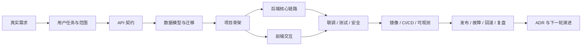

# 编程综合训练项目方案

日期：2026-11-19

## 1. 目标

综合训练不是课程末尾的一道练习题，而是从零基础到企业交付的第二条学习主线：

- 不要求学习者先学完全部语言。
- 每个项目都从需求理解开始，不从脚手架开始。
- 每个阶段都进入单步沉浸学习台，退出后回到项目主线。
- 项目必须覆盖接口、数据、前后端、测试、安全、部署、观测和运维。
- 同一个业务能力可以在单体、多模块和微服务项目里看到不同代价，避免把某种架构当唯一答案。

## 2. 项目矩阵

| 项目 | 类型 | 难度 | 核心能力 | 技术栈 |
| --- | --- | --- | --- | --- |
| Studio 企业官网 | 前端项目 | 零基础 | 语义、响应式、表单、SEO、无障碍、静态发布 | HTML5、CSS3、TypeScript、Vite、Playwright、Lighthouse |
| Pulse 实时驾驶舱 | 现代全栈 | 入门到进阶 | RSC、实时流、缓存、断线恢复、可访问图表 | Next.js、React、FastAPI、PostgreSQL、Redis、SSE |
| TeamFlow 协作 SaaS | 全栈单体 | 企业进阶 | 多租户、对象级授权、审计、Outbox | Vue 3、Spring Boot、Security、PostgreSQL、RabbitMQ |
| Commerce 模块化电商 | 多模块单体 | 企业进阶 | 模块边界、订单状态机、库存并发、支付幂等 | Java 21、Gradle 多模块、Kafka、Testcontainers |
| Orbit 内容社区微服务 | 微服务 | 企业进阶 | 网关、BFF、服务所有权、事件契约、Trace | React、Spring Cloud Gateway、Kafka、Go、K8s |
| Atlas AI 知识助手 | AI 全栈 | 企业进阶 | RAG、引用、SSE、取消、Tool Calling、评测 | React、Spring AI、pgvector、Redis、OpenTelemetry |
| Nimbus 预约票务 | 云原生后端 | 企业进阶 | 并发预约、事务、幂等、KEDA、回滚 | Go、Gin/gRPC、PostgreSQL、Redis、Kafka、K8s |
| LogForge 日志采集器 | 系统底层 | 企业进阶 | Asio、有界队列、协议、背压、sanitizer | C++20、Boost.Asio、Go、Protobuf、ClickHouse |
| LaunchPad 发布平台 | 交付平台 | 企业进阶 | GitOps、审批、金丝雀、SLO、故障演练 | React、Go、Argo CD、Helm、Prometheus |
| Canvas 实时协作 | 实时协作 | 企业进阶 | CRDT、WebSocket、presence、离线恢复 | React、Yjs、Go、Redis、PostgreSQL、S3 |
| DataFlow 数据平台 | 数据平台 | 企业进阶 | 批流一体、数据契约、血缘、质量门禁 | Python、Dagster、dbt、Kafka、ClickHouse |
| SecureVault 安全笔记 | 安全产品 | 企业进阶 | OIDC、对象授权、客户端加密、事故响应 | React、Go、WebCrypto、KMS、PostgreSQL |
| DevKit 开源工具 | 开发者工具 | 企业进阶 | CLI/SDK 契约、跨平台发布、SLSA、签名 | TypeScript、Go、GitHub Actions、Cosign |

## 3. 统一项目生命周期

每个项目固定 10 个训练阶段。阶段固定，但项目内容、接口、数据、风险和验收全部按项目单独定义。

| 阶段 | 学习重点 | 阶段产物 |
| --- | --- | --- |
| 01 业务理解与用户任务 | 角色、目标、主流程、替代方案、非目标 | 用户任务卡、流程图、非目标清单 |
| 02 范围、验收与非功能目标 | MVP、验收场景、性能、安全、可用性 | 范围表和可观察验收条件 |
| 03 API 契约与前端数据边界 | 资源、方法、错误、分页、幂等、版本 | API 契约、错误模型、请求矩阵 |
| 04 数据模型、约束与迁移 | 实体、状态机、索引、事务、回填 | ER 图、迁移和回滚脚本 |
| 05 项目骨架、模块边界与本地环境 | 目录、模块、依赖方向、Docker Compose | 可复现工程骨架 |
| 06 后端核心链路与异常恢复 | 校验、权限、事务、重试、超时、幂等 | 后端接口、失败恢复和测试 |
| 07 前端页面、状态与可访问交互 | 路由、状态、表单、加载、错误、移动端 | 可访问前端和断点矩阵 |
| 08 联调、测试、安全与性能 | 契约、集成、E2E、IDOR、性能实验 | 测试和安全报告 |
| 09 容器、CI/CD、可观测与发布 | 镜像、配置、日志、指标、Trace、回滚 | 发布流水线和仪表盘 |
| 10 故障演练、回滚与项目答辩 | 容量、故障、恢复、ADR、运行手册 | 演练报告和答辩材料 |

## 4. API 设计准入

项目接口必须遵守以下硬约束：

1. 输入和输出有明确 schema，外部数据在边界校验。
2. 列表接口默认分页。
3. 错误统一为机器可读 code、可行动 message 和可选 details。
4. 写操作定义幂等策略；未知网络结果按“可能成功”处理。
5. 状态码表达协议结果，业务错误码表达领域结果。
6. 新增字段优先保持向后兼容，删除或改语义必须设计版本迁移。
7. 授权同时检查主体、动作和资源归属，不能只做 URL 级鉴权。
8. 流式接口明确首字节、心跳、取消、背压和代理缓冲。

## 5. 项目运行图

## 6. 前端与移动端

- 桌面课程中心使用“独立课程 / 综合训练”分段控制。
- 项目选择页支持按项目类型筛选。
- 项目详情显示价值、技术栈、架构、交付物、指标、运行图和 10 个阶段。
- 移动端项目卡单列，筛选和运行图横向滑动，页面本身不得横向溢出。
- 所有筛选、项目卡和阶段按钮触控目标至少 44px。
- 阶段点击进入现有沉浸学习台，底层课程中心进入 inert 状态，焦点不得逃出。

## 7. 零基础路径

零基础推荐从 Studio 企业官网开始，掌握：

1. 需求和页面结构。
2. HTML/CSS/TypeScript 最小工程。
3. 响应式、键盘和表单。
4. 静态 API mock 与错误状态。
5. 构建、CDN/Nginx、Lighthouse 和回滚。

随后进入 TeamFlow 全栈单体，再根据目标选择：

- Java 企业路线：Commerce 多模块 → Orbit 微服务。
- AI 路线：Atlas RAG → LaunchPad 交付治理。
- Go 路线：Nimbus 票务 → Orbit 通知服务。
- 系统路线：LogForge → LaunchPad 故障演练。

## 8. 验收

- 13 个项目、130 个阶段课时全部可进入。
- 每个阶段有 5 步教案、来源、失败边界和独立产出。
- 项目必须从需求、契约和数据开始，不能直接跳到 CRUD。
- 每个项目至少包含一个架构边界、一个并发或一致性风险、一个安全风险和一次回滚。
- 项目完成后应形成可运行代码、测试、镜像、运行图、监控、运行手册和答辩记录。
