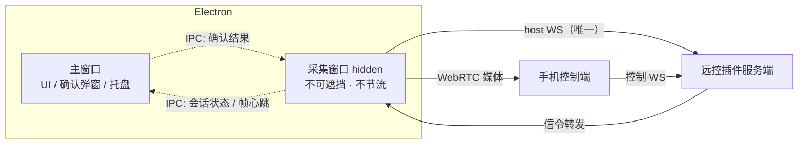
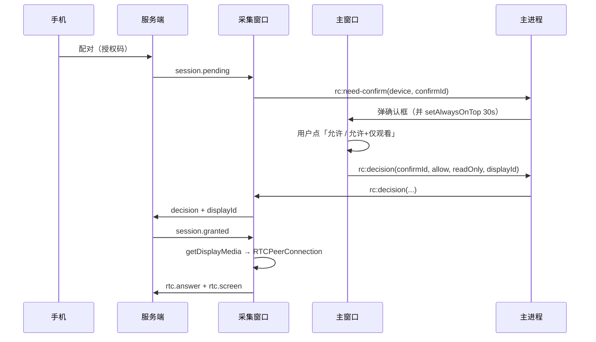

# 远控阶段 1：采集与 UI 解耦方案

> 2026-10-27 · 针对「被控端窗口被遮挡 → 画面冻结 → 用户以为完全控制不了」

## 1. 问题与目标

### 1.1 现状缺陷

被控端的屏幕采集与 WebRTC 编码跑在**主窗口的渲染进程**里（`RemoteControlHost.vue` 调 `getDisplayMedia` 并持有 `RTCPeerConnection`）。因此：

- 主窗口被其它应用全屏遮挡 → Chromium 遮挡节流 → 采集与编码一起停
- 控制端看到最后一帧定格，注入其实还在生效，但用户没有反馈回路
- 切副屏、请求关键帧同样要经过被冻结的渲染器，全部失效

启动参数（`disable-backgrounding-occluded-windows` 等）是止血，不是根治：只要「界面可见性」和「画面输出」在同一个渲染进程里，这类耦合就还在。

### 1.2 阶段目标（可验收）

| # | 验收项 | 判据 |
|---|---|---|
| A1 | 主窗口被全屏应用完全遮挡 10 分钟 | 控制端画面持续更新，端到端延迟 < 200ms |
| A2 | 主窗口最小化 / 切到其它桌面 | 画面不冻结 |
| A3 | 切换显示器 | 3s 内画面与几何（`rtc.screen`）一致 |
| A4 | 采集进程崩溃 | 5s 内自动重建，会话不断开 |
| A5 | 原有能力 | 确认弹窗、仅观看、隐私屏、托盘断开全部保持 |

## 2. 方案对比

### 方案 A：专用采集窗口（隐藏 BrowserWindow）

采集窗口独立于主窗口，`backgroundThrottling: false` + `show: false`，由它独占 `getDisplayMedia` 与 `RTCPeerConnection`；主窗口只做 UI 与确认弹窗。

- **好处**
  - 复用全部现有 WebRTC 代码路径，协议零改动
  - 与主窗口的可见性彻底解耦，A1/A2 直接满足
  - 改动集中在窗口生命周期与信令归属，1~2 天可落地
  - 出问题可一键回退到主窗口采集
- **坏处**
  - 采集仍在 Chromium 渲染管线内，理论上仍可能被平台级挂起（需要真机长测）
  - 多一个隐藏窗口，内存约 +80~150MB
  - 确认弹窗与采集窗口跨进程协作，信令路径变长

### 方案 B：C# 代理采集裸帧 → 渲染进程注入

C# 用 DXGI Desktop Duplication 出 BGRA 帧，经共享内存/消息传给渲染进程，渲染进程组 `VideoFrame` 再交给 WebRTC。

- **好处**
  - 采集完全脱离 Chromium，彻底免疫遮挡/节流
  - DXGI 性能优于 WGC，可拿到脏矩形做增量
- **坏处**
  - 1080p30 的 BGRA 是 **250MB/s**，跨进程即使零拷贝，也要在渲染进程做一次 GPU 上传，CPU/带宽代价高
  - 要用 `VideoFrame` 喂给 WebRTC，需要 `MediaStreamTrackGenerator` 或 canvas 中转，前者在 window 上下文的可用性随版本变动，后者每帧一次 GPU 拷贝
  - 注入后 WebRTC 还要再编码一遍，等于「采集 → 搬运 → 编码」，链路比现在更长
  - 工作量约 1~2 周，且大部分复杂度花在搬运上

### 方案 C：C# 采集 + 硬编 + 直接打 RTP

C# 用 Media Foundation 硬编 H.264，经 `RTCRtpScriptTransform` 直接塞 RTP，跳过 WebRTC 编码器。

- **好处**
  - 延迟最低、CPU 最低，是 RustDesk/ToDesk 一类产品的最终形态
- **坏处**
  - 等于重做媒体通道：时间戳、关键帧、NACK/PLI、码率自适应都要自己接
  - 属于阶段 2/3，不是阶段 1 的范围

### 结论

**阶段 1 走方案 A。** 方案 B 的裸帧搬运性价比很低——花两周把采集挪出去，却把 250MB/s 的搬运放进热路径；同样的工程量应该直接做方案 C（阶段 2），一步到位。方案 A 用一天解决今天的问题，并为方案 C 留好窗口边界。

## 3. 目标架构



关键不变式：

1. **host WS 只有一条，且由采集窗口持有**（现有代码里 `hostConn` 是单例，多一条会互相顶掉——这正是之前"切屏不生效"的隐患之一）。
2. 主窗口不再 `getDisplayMedia`、不再持有 `RTCPeerConnection`。
3. 确认弹窗仍在主窗口（必须让用户看见），但 `decision` 由采集窗口发往服务端。

## 4. 详细设计

### 4.1 进程与窗口

| 对象 | 职责 | 生命周期 |
|---|---|---|
| 主窗口 | 远控页 UI、配对确认弹窗、托盘状态 | 常驻 |
| 采集窗口 | `getDisplayMedia`、`RTCPeerConnection`、host WS、显示器切换 | 按需创建，会话结束 5s 后销毁 |

采集窗口参数：

```js
new BrowserWindow({
  show: false,
  skipTaskbar: true,
  focusable: false,
  webPreferences: {
    backgroundThrottling: false,
    nodeIntegration: false,
    contextIsolation: true,
    preload: path.join(__dirname, 'capture-preload.cjs'),
  },
});
```

必须同时保留已加的启动参数（`disable-renderer-backgrounding` 等）——它们对采集窗口同样生效，是双保险。

### 4.2 创建时机

主进程不再依赖渲染层轮询来决定（渲染层可能被冻住），改为**双触发**：

1. 服务端会话事件（新）：插件在 `session.pending` / `granted` 时通过 IPC 推送 `rc:capture-ensure`
2. 保底：主窗口 `/status` 轮询发现会话时调 `rc:capture-ensure`

采集窗口创建后加载 `capture.html`，页面内调用 `rc:capture-ready`，主进程再回 `rc:capture-ensure` 的会话参数。

### 4.3 信令归属与确认流程



现有 `RemoteControlHost.vue` 拆成两部分：

- `useRcHostSignaling()`（新 composable）：WS、配对、采集、`rtc.*`、`displays` —— 跑在采集窗口
- `RemoteControlHost.vue`：确认弹窗、`rcSessionState` 上报、`onRcDisconnectAll` —— 留在主窗口

### 4.4 新增 IPC

| 通道 | 方向 | 载荷 | 用途 |
|---|---|---|---|
| `rc:capture-ensure` | 主 → 采集 | `{ sessionId? }` | 确保采集窗口存在并加载 |
| `rc:capture-ready` | 采集 → 主 | `{ ok }` | 采集窗口就绪 |
| `rc:need-confirm` | 采集 → 主 | `{ confirmId, device, displays }` | 请求主窗口弹确认框 |
| `rc:decision` | 主 → 采集 | `{ confirmId, allow, readOnly, displayId }` | 用户决定 |
| `rc:frame-tick` | 采集 → 主 | `{ at, fps, bitrate }` | 画面健康心跳 |
| `rc:capture-restart` | 主 → 采集 | `{}` | 看门狗重建 |

注意：`rc:capture-restart` 优先销毁重建窗口，而不是 `reload()`——渲染器已卡死时 reload 不可靠。

### 4.5 看门狗

主进程每 2s 检查最近一次 `rc:frame-tick`：

- 超过 4s 无心跳 → 判定画面停摆
- 连续 2 次判定 → 销毁并重建采集窗口，保留会话（采集窗口重新走 `session.resume` 拿 token）
- 重建期间控制端显示「画面重连中」，不直接断会话

同时在采集窗口内部做一层：`RTCPeerConnection.getStats()` 每 3s 取 `framesEncoded`，若 10s 无增长则主动请求关键帧（`sender.setParameters` 触发 PLI）。

### 4.6 显示器切换

采集窗口持有 `captureDisplayId`，切换流程不变（`applyCaptureDisplay` → `getDisplayMedia` → `replaceTrack` → `syncCapturedDisplay` → `sendScreenAndDisplays`）。窗口隐藏不影响 `getDisplayMedia` 的多屏选择。

### 4.7 隐私屏与托盘

- 隐私屏窗口由主进程创建（已有），与采集窗口无关
- 托盘「远控中」状态继续由主窗口的 `/status` 轮询上报；若主窗口被遮挡导致轮询变慢，改由**主进程**直接根据采集窗口心跳维护托盘状态

## 5. 迁移步骤

| 步 | 内容 | 可独立验证 |
|---|---|---|
| 1 | 抽出 `useRcHostSignaling()`，主窗口行为不变 | 现有单测 + 真机连一次 |
| 2 | 主进程 `createCaptureWindow()` + `capture.html` + preload | 窗口能起、能拿到 `rc:capture-ready` |
| 3 | 采集窗口接管 host WS 与采集；主窗口停止 `getDisplayMedia` | 控制端能看到画面 |
| 4 | 确认弹窗跨进程联动（`rc:need-confirm` / `rc:decision`） | 配对全流程走通 |
| 5 | 看门狗 + 重建 | 手动杀采集窗口进程，观察自愈 |
| 6 | 默认开启；保留开关 `remoteControl.legacyCaptureWindow=true` 回退 | 遮挡 10 分钟长测 |

每步都可单独回滚，1~3 步不改变对外协议。

## 6. 风险

| 风险 | 影响 | 应对 |
|---|---|---|
| 隐藏窗口被平台挂起 | 画面仍冻结 | 启动参数 + `backgroundThrottling:false` + 看门狗重建；真机长测 A1 |
| 采集窗口与主窗口的 WS 抢连 | 会话被顶掉 | host WS 只允许采集窗口连接；主窗口启动时显式禁用 |
| 确认弹窗时机 | 用户看不到弹窗导致配对超时 | 保留 `rc:raise` 30s 置顶；弹窗与采集窗口解耦 |
| 采集窗口内存 | 常驻进程内存上涨 | 会话结束 5s 销毁；不在空闲期常驻 |
| `getDisplayMedia` 在 hidden 窗口被拒 | 采集失败 | 允许 `show:false` 时先 `showInactive()` 再采集，采集成功后 `hide()`；失败则回退主窗口采集并上报 |

## 7. 与阶段 2 的衔接

阶段 1 只解决「谁持有采集与编码」。真正的延迟/CPU 优化留给阶段 2：

- 采集：DXGI Desktop Duplication（脏矩形 + 变化检测）
- 编码：Media Foundation 硬编（NVENC / QSV / AMF）
- 传输：`RTCRtpScriptTransform` 直接塞 H.264 NAL，或私有 UDP

这些都在采集窗口/独立进程内部替换，**对外协议与 UI 不变**——这也是阶段 1 值得先做的原因。
